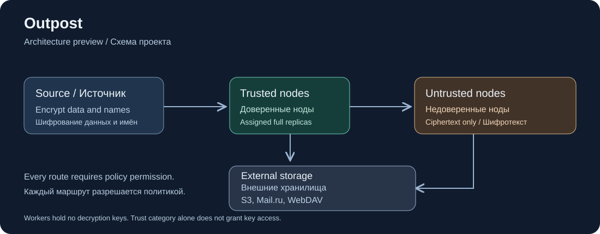

# Outpost

[Current component acceptance](docs/en/component-acceptance.md) verifies downloaded 8c installation/upgrade/rollback, separately versioned predecessor checks, actual pinned Collector logs/metrics and four matched 128 MiB cases with 24 fresh offline restores. The [100 GiB external fixture](docs/en/full-external-scale.md) records seven independent restores using isolated S3-compatible and WebDAV targets. Live target admission and full asymmetric acceptance remain open.

[Copy verification](docs/en/copy-observations.md) can advance across several bounded batches per attempt after it saves progress. A signed observation retains the time of the oldest supporting read. The [asymmetric test profile](docs/en/asymmetric-source.md) records why the previous one-hour synthetic window could not finish a full-size case and defines the window for a corrected run.

The [management UI](docs/en/management-ui.md) shows the original verification time and scope of a confirmed restore. A verified whole-generation restore provides a dated measurement of logical bytes. The management API can also show the earliest full restore retained in the node's report. Owners can read the original report time for a complete generation on an assigned trusted holder. Running external upload jobs can show the ciphertext part bytes confirmed by the reporting worker. [Policy preview](docs/en/management-api.md) flags a shortfall supported by a fresh signed volume report and shows declared ciphertext volumes for explicit external plans and for one peer transfer with its exact signed catalog. The [Btrfs producer](docs/en/prepared-exports.md) checks the retained snapshot count and optional free-space floor before each new snapshot attempt.

[Source](docs/en/source-agent.md) and [worker](docs/en/peer-transfer.md) HTTP body limits are configured locally. [File-kit repack and export](docs/en/file-kit-format.md) check peak extra allocation before writing and support an optional free-space reserve.

The [owner export correction](docs/en/owner-export-mount.md) accepts the same enrolled source after a mount-namespace restart and pins a fresh observation during export. Its bounded HDD controls also cover all configured ingress receivers being unavailable. The prior 100 GiB run completed three captures but failed before recovery export; the [separate composed recovery workflow](docs/en/source-ingress-scale.md) now verifies both retained versions with four fresh offline restores.

The [verification work correction](docs/en/verification-batch.md) removes repeated prefix stamp scans while retaining the final publication sweep. Controlled HDD and race checks pass; the failed 36-hour full-size run remains unaccepted.

[Русский](README.ru.md)

[Real source expiry](docs/en/source-agent.md#real-authority-expiry-on-the-hdd) now has a current, explicitly enabled HDD receipt for expired ACTIVE retirement and offline split-coverage publication. The three bounded native cases preserve authority, receipt-time and release thresholds; physical 100 GiB and product acceptance remain separate.

The [actual CLI process flow](docs/en/process-flow.md) runs a selected distribution for source capture and two autonomous receiver processes. Its [bounded HDD receipt](docs/cli-process-flow-evidence.json) records outbound-only catch-up after source/center loss, unchanged restart receipts, four independent materialized restores and rejection of wrong artifact selections. The 2 MiB fixture complements the separate full-size and isolation gates.

[Bounded verification windows](docs/en/verification-windows.md) continue peer generation checks across HTTPS requests and cloud object hashing across physical parts. Receipts preserve original read time. Short tests exercise interrupted progress, fresh operations, legacy peers, corruption and independent recovery; this does not close the full product or large-scale gates.



Autonomous encrypted backups with complete assigned replicas, granular placement and recovery after long disconnections.

**Stage: M0; G1 accepted, G2/G3 implementation candidates.** The [G1 file-kit format](docs/en/file-kit-format.md) streams files into encrypted objects and restores a selected version without a global repository index. Typed kits also preserve directory attributes and symbolic links without following their targets; regular files retain the original format. There is no production backup service yet. Start with the [specification](docs/en/specification.md) and [G1-G3 feasibility gates](docs/en/roadmap.md). The previous receiver remains in [outpost-legacy](https://github.com/nd4y/outpost-legacy).

The [source-authority CLI check](docs/en/source-agent.md#renewing-source-authority) verifies renewal through a real selected executable and refusal of the migrated state by a pinned source-built predecessor. Its [HDD receipt](docs/source-renewal-cli-evidence.json) keeps the downloaded current revision, comparator origin and native CI stages distinct.

The [direct requirement facets](docs/en/requirement-facets.md) distinguish component/reader pinning, key capabilities and the explicit 180-update profile from adjacent SDK, delegation and ordinary catch-up checks. Links preserve the original execution and acceptance boundaries.

[Focused kit rejection](docs/en/filekit-negative.md) checks the missing final multipart descriptor part, authenticated equal-size part reordering, trailing descriptor data and absent output after version/ciphertext substitution. Both exported kits are scanned for synthetic private markers; [the scoped receipt](docs/filekit-negative-evidence.json) keeps placement and full-scale admission separate.

The [G1 acceptance record](docs/en/g1-acceptance.md) covers encrypted names, old/new versions, attributes, multipart descriptors, tamper rejection, actual SIGKILL boundaries and concurrent maintenance. Its physical 100 GiB/8 MiB run passed all 23 phases, including independent old/new recovery after repack and retirement. Added ciphertext and metadata for the contiguous change total 31,103,218 bytes, below 128 MiB. The [scoped receipt](docs/g1-scale-evidence.json) identifies the tested source and costs; G2/G3, whole-product acceptance and production deployment remain separate.

The local CLI accepts regular source and owner-key files. It rejects symbolic links and named pipes without waiting for a pipe writer; recovery keys must have private filesystem permissions. Restored names must fit Linux byte limits (255 per component, 4095 per relative path), so unsupported names fail before capture.

The [G2 generation/replica candidate](docs/en/generation-replicas.md) adds signed complete catalogs, keyless reception, restart-safe progress, persistent pins and separately authorized cleanup. Its compact local history index has explicit migration and guarded rollback commands; wire catalogs and existing file kits remain compatible. Small HDD tests cover checkpoint catch-up, source repack, actual process termination and independent old/new restoration. Heavy scale/endurance tests remain deferred; this is not full G2 acceptance or a network service.

The [bounded G2 receipt](docs/g2-history-evidence.json) records180actual64KiB updates with the third holder offline, interrupted direct catch-up and independent old/new recovery. A separate holder check covers real TLS epoch transition, old-branch revocation and persistent rollback fences. These checks do not accept full distributed scale.

When an [approved historical pull](docs/en/peer-transfer.md#retry-durability-and-resource-limits) finds the exact generation already retired locally, it releases its own source lease and keeps the existing replica head.

The [specification 1.5](docs/en/specification.md) requires parallel capture across authorized receivers, forwarding before generation sealing and a policy-defined release threshold. The [two-holder source candidate](docs/en/source-agent.md#parallel-capture-to-two-required-holders) forwards accepted packs before seal, keeps the verified two-full-copy default and offers explicit early release when both holders each cover the whole catalog or their assigned share. Workers can finish publication with the source offline. The candidate renews both grants in one signed source update.

The [asymmetric source method](docs/en/asymmetric-source.md) compares a single initial recipient with the adaptive pair under declared 500/500/100 Mbit/s body caps, separately from wire throughput. Equal-rate split writes can use an idle initial receiver while their required owner is occupied. Exact owner delivery, release proofs, retained recovery and the separate physical 100 GiB gate remain explicit.

The [G3 peer candidate](docs/en/peer-transfer.md) adds mutually authenticated HTTPS push/pull, durable operation journals and complete publication through an asynchronous bridge. Bounded fault tests include false acknowledgments, lost replies, cancelled parallel reads and independent restoration after source/bridge loss. Push defaults to full target readback; an explicit [reuse policy](docs/en/readback-reuse.md) retains original evidence age while avoiding unchanged-object downloads. The [external-upload candidate](docs/en/external-upload.md) adds S3-compatible/WebDAV adapters, three independent workers, cached signed plans, resumable multipart planning, failover and independently recoverable target generations. A separate owner policy enables cloud readback reuse with exact descriptor binding and original evidence age. [Bounded signed claims and journal checkpoints](docs/en/upload-checkpoints.md) preserve original assignment expiry and full publication checks while reducing repeated metadata writes. Real endpoint admission, full traffic accounting and heavy G3 acceptance remain open.

The [controlled G3 measurements](docs/g3-latency-evidence.json) retain all earlier failures. Bounded signed claims and journal checkpoints now pass the unchanged150ms threshold on both protocols (1.625/1.602), the500ms/12s rotation/lost-part cases and independent old/new recovery. [Scoped race and previous-reader checks](docs/en/upload-checkpoints.md) pass separately. Full short-deadline HDD regressions and real infrastructure/full G3 admission remain open.

The [idle polling receipt](docs/upload-idle-evidence.json) separates the verified reduction in waiting-worker requests and ordinary offline cloud recovery from an unresolved12s slot regression on the shared busy HDD. Full G3 throughput remains open.

S3-compatible signing now uses pinned SDK/protocol components with explicit credentials and the existing Outpost request limits. Independent signatures and real signed-framing checks are documented in the [storage adapter](docs/en/external-upload.md#request-signing-components); endpoint and full-product acceptance remain separate.

The [durable upload queue](docs/en/upload-queue.md) now admits signed plans, pins sources and runs independent targets with bounded concurrency, automatic delayed retries and process-crash recovery. Expired or permanently blocked jobs remain explicit and protected.

The [source and recovery components](docs/en/product-development.md) include bounded alias-aware scanning, a metadata-only streaming cache and whole-replica/directory recovery without the state index. [Authenticated source ingress](docs/en/source-ingress.md) adds current-policy admission, bounded verification and durable acknowledgement cleanup to workers. `restore-replica` validates an explicit checkpoint and publishes a complete selected result atomically. The [private source agent](docs/en/source-agent.md) now runs restartable best-effort capture over HTTPS and prepares the next signed generation. [Autonomous replication](docs/en/autonomous-replication.md) discovers new complete generations under explicit owner rules. [Signed copy observations](docs/en/copy-observations.md) support two-copy release through an outbound-only relay. The prepared provider accepts read-only Btrfs snapshots with native identity checks. Other filesystem providers and application-specific admission remain in development.

An optional [write-ahead source journal copy](docs/en/source-journal-copy.md) repairs a missing main journal from the exact signed state when the admitted copy and required capture records survive.

The [native Btrfs producer](docs/en/prepared-exports.md#native-btrfs-producer) creates one read-only snapshot for a durable signed operation. A separate producer action consumes the source's signed release ticket and removes the exact subvolume.

The `source-status` command reports the expiry of pending work and indicates whether the operator can resume it or needs owner action or receiver reconciliation. An expired operation prepared locally can be retired with owner approval until execution reaches the receiver fence.

For active and completed operations, `source-status` reports when the source observed release of its view and when checkpointed replicas verified their ciphertext. Independent decryption has its own restore receipt.

Ask for `--capture-measurements` to see plaintext bytes read and new ciphertext recorded in the current route's verified file receipts. [Source status fields](docs/en/source-agent.md) describe the measurement limits.

[Automatic receiver replacement](docs/en/source-agent.md#automatic-replacement-after-active) supports a standby for one copy and a reserve for two. Paired capture adjusts initial transfers to measured receiver throughput, including split coverage with a direct handoff to the assigned holder. Before full publication the worker estimates additional space from the signed catalog. With a complete surviving closure, the pair replays the signed catalog and reclaims the old slot after catch-up. [Scoped recovery](docs/en/source-settlement.md) lets both holders finish staged publication after expiry and distinguishes an unadmitted source operation from retained receiver work.

An [expired unsealed capture](docs/en/source-settlement.md#retire-an-admitted-capture-before-sealing) can retire with exact owner grants and evidence from every possible receiver. The old slot retains its staging until a fresh attempt is admitted at the same sequence and predecessor.

Worker bootstrap now requires [runtime volume admission](docs/en/runtime-volume.md). Missing markers or replaced paths stop work, while opened descriptors keep writes on the admitted tree. Encrypted per-file progress reuses accepted packs after a crash; the source is still reread. The [source job lifecycle](docs/en/source-jobs.md) defines enforced checkpoint/release ordering and the remaining network copy-threshold integration.

[Trusted content verification](docs/en/trusted-verification.md) decrypts selected retained versions without plaintext output or a replica index. Private reports preserve per-version outcomes and original check times; partial checks return a failure status. Ordinary workers remain keyless.

The [bounded source-ingress receipt](docs/source-ingress-evidence.json) records one full-catalog upload across multiple verification batches, legacy compatibility and actual expiry refusals. A physical 128 MiB source rehearsal and two clean-consumer complete-replica restores prepare the separate 100 GiB stage; they do not establish full-scale acceptance.

The [bounded maintenance-plan receipt](docs/maintenance-plan-evidence.json) covers export and exact restoration of a lost frozen deletion plan, including real process termination, stopped-worker admission and the selected CLI. The current index and signed retention ledger must survive; combined metadata loss remains open.

[Whole-operation windows](docs/en/operation-windows.md) let the owner explicitly admit long generation work while keeping short request, claim and authority deadlines. Omitted settings preserve the prior effective budget and default queue identity.

## Planned workflows

- Back up a dataset once at the source and distribute complete encrypted replicas across permitted nodes.
- Restore one retained file version independently, including when other nodes and the control plane are unavailable.
- Reconcile and repair replicas after weeks or months offline, using authorized intermediate nodes when direct links are impossible.

## Storage and privacy

Policies distinguish **trusted nodes**, **untrusted nodes** and **external storage** using S3-compatible APIs or WebDAV. Each dataset selects permitted categories, concrete recipients and transit routes. Untrusted workers receive ciphertext without decryption keys. Trusted worker status alone grants no decryption rights. External storage is a backend, not an implicit worker.

Names and file metadata are encrypted at the source. Technical sizes, timing and block-reuse patterns are not hidden. A complete replica covers its assigned datasets and retained versions. Every cloud target must be independently complete for its assignments; eligible workers divide uploads.

## Read and check this repository

```sh
git clone https://github.com/nd4y/outpost.git
cd outpost
npm ci --prefix .standards --ignore-scripts --no-audit --no-fund
node .standards/install-gitleaks.mjs
node .standards/install-hooks.mjs
node .standards/check.mjs structure
node scripts/check-docs.mjs
node scripts/check-format.mjs
```

These commands validate documentation and the standard toolkit. They do not start a backup service. Development requires Git, Node.js 22+, npm, tar and a POSIX shell for hooks; CI pins its exact versions. The G1 CLI targets Linux and reuses the pinned restic chunker with standard Go cryptography. The older restic 0.19.1 experiment remains a comparison; planned workers target Linux amd64/arm64.

## Documentation

- [Project passport and workflows](docs/en/project.md)
- [Technical specification 1.5](docs/en/specification.md)
- [Milestones and open acceptance](docs/en/roadmap.md)
- [Product completion and signed configuration](docs/en/product-development.md)
- [Development standard and commands](docs/en/development-standard.md)
- [Audit against all 45 rules](docs/en/standard-review.md)
- [G1 executable experiment and limits](docs/en/g1-prototype.md)
- [Independent file-kit format and engine decision](docs/en/file-kit-format.md)
- [G1 acceptance, cost bounds and commands](docs/en/g1-acceptance.md)
- [Infrastructure profile contract](docs/en/infrastructure-profile.md)
- [Machine-readable requirement trace](docs/requirements.json)
- [G1 requirements linked to executable checks](docs/g1-trace.json)
- [G2 generation and replica contracts](docs/en/generation-replicas.md)
- [G2 scoped requirement-to-check trace](docs/g2-trace.json)
- [G3 peer protocol, evidence and limits](docs/en/peer-transfer.md)
- [Distributed external upload, recovery and limits](docs/en/external-upload.md) - S3-compatible and WebDAV targets with bounded repeated capability checks.
- [Delayed archive recovery](docs/en/archive-recovery.md) - selected S3 retrieval with signed part maps, bounded cost and a temporary availability window.
- [Autonomous external planning](docs/en/delegated-upload.md)
- [Immutable-object readback reuse contract](docs/en/readback-reuse.md)
- [G3 scoped requirement-to-check trace](docs/g3-trace.json)

[Repository checks](https://github.com/nd4y/outpost/actions) assess source/documentation mechanics. Product builds, releases, installation, restore and runtime acceptance remain separate. The pinned toolkit is autonomous and needs no private-repository credentials. CI verifies the unchanged scanner checksum even when using the official release API download route.

## Support and licensing

Track design defects and scoped proposals in [Issues](https://github.com/nd4y/outpost/issues). Use [SECURITY.md](SECURITY.md) for sensitive reports. No runtime compatibility or response-time SLA is promised at this stage. [CONTRIBUTING.md](CONTRIBUTING.md) explains bilingual PRs and owner merges.

Original project material is [MIT licensed](LICENSE). The vendored toolkit retains its [MIT notice](.standards/LICENSE). Restic and other future runtime dependencies retain their own licenses; none is bundled as a product release here.

The private source agent supports a [durable interval schedule](docs/en/source-scheduling.md) with pause, restart and unchanged pending-operation recovery. Explicit source-authority renewal preserves that history and migrates the signed journal without expanding scope. Initial installation publishes only a complete runtime, keeps interrupted candidates and bounds retries. Full product acceptance remains open.

The [management API candidate](docs/en/management-api.md) supports signed configuration, durable original-age reports and a signed command queue. Workers persist pause/resume across restart and policy changes, join active transfers before acknowledging pause, and retry the same receipt after a lost reply. Blocked-job retries use a durable token across worker/upload journals and never repeat a completed upload. Foreground reporting and command polling remain independent of backup execution. Asynchronous ciphertext scrub and separately signed maintenance preserve original results across restart. Signed reports expose bounded command progress separately from backup jobs. [Authorized replica repair](docs/en/integrity-repair.md) preserves quarantine and repairs detected damage through existing push/pull routes. [Trusted recovery](docs/en/trusted-recovery.md) and the [private management service](docs/en/management-service.md) have short process checks; the [bilingual operator interface](docs/en/management-ui.md) now has isolated browser checks for coverage, signed-policy preview and exact recovery requests. The persistent browser journal preserves exact retries across closed tabs and browser restart, coordinates concurrent tabs and rejects unsafe storage failures. Never-admitted request refusal has a bounded implementation candidate; external-target coverage, manual accessibility and full product acceptance remain open.

[Trusted recovery](docs/en/trusted-recovery.md) connects signed restore commands to a private local executor with separate output admission, atomic bundles, historical receipts and versioned reports. The normal worker remains keyless.

[Catalog repair](docs/en/integrity-repair.md#unreadable-catalogs) isolates damaged metadata without hiding healthy generations, preserves the original in quarantine and restores it through explicitly authorized peers.

[Management service commands](docs/en/management-service.md) provide private initialization, runtime status, profile revision, bounded reconciliation and TLS serving. Stop/join, volume-loss and real process-kill checks run on isolated fixtures; no live installation is implied.

Owners can now review and abandon an admitted request only while its effect remains unpublished. An independent resolution receipt and audit preserve the original request; replay cannot execute it. Published commands and durable configuration effects are refused. [The lifecycle contract](docs/en/management-service.md#resolving-unpublished-intents) describes the format fence, retained checkpoint and remaining recovery work.

The [private management snapshot](docs/en/management-snapshots.md) preserves administrative history and independently verifies a selected checkpoint without activating historical commands.

The [owner audit](docs/en/management-api.md) also records the original admission of staged retention steps, including steps still waiting to publish.

The interface now shows [external-copy observations](docs/en/external-copy-reporting.md) with their original verification time and explicit unknown state.

The [Linux distribution candidate](docs/en/distribution.md) builds source-bound amd64/arm64 archives and a shellless container input; installation and runtime acceptance remain explicit gates.

The [durable telemetry process](docs/en/telemetry.md) provides a signed bounded OTLP queue, retained source positions, explicit scope renewal and independent delivery. A transport outage keeps accepted records pending across restart for delivery to the same admitted recipient; arbitrary recipient diagnostics are excluded from the journal and status. Short checks include a real collector and backup/restore during a slow sink; complete instrumentation and operational acceptance remain open.

The [monitoring rules](docs/en/telemetry.md#monitoring-rules-and-independent-watchdog) distinguish missing telemetry from measured failures and provide a separate watchdog for receipt of the monitoring heartbeat.

With `observeLocalReplicaDamage` enabled, `OutpostLocalReplicaCorrupt` reports damage recorded in the latest known local inventory. The worker keeps damage unknown when the inventory cannot be read.

The opt-in `observeRestoreFailures` measurement shows retained terminal failures of managed restore commands and their latest original finish time.

The [owner recovery package](docs/en/owner-recovery-package.md) keeps read-only decryption material, original checkpoint age and selected offline tools in private owner storage. The [key epoch preparation](docs/en/owner-recovery-package.md#prepare-a-new-key-epoch) creates a separate domain and records the authenticated prior package and checkpoint. Activation, retirement and full-scale acceptance have separate gates.

The [expired-operation settlement workflow](docs/en/source-settlement.md) retrieves only an already durable original receipt under fresh owner permission and current receiver policy. It preserves original verification age and the independent-copy threshold. Missing receipt or expired observation permission remains pending; an immutable write intent is never renewed by settlement.

The [receiver renewal workflow](docs/en/receiver-renewal.md) admits a fresh same-scope grant in the existing registry after explicit quiescent maintenance. It preserves historical receipts and generations, fences previous readers and uses the current receiver policy and disk budget.

[Missing receipt recovery](docs/en/receipt-recovery.md) uses separate fresh owner permission and current receiver policy to reconstruct a receipt only from an already complete generation and unchanged original publication proof. It preserves the original verification age and signed audit; ordinary settlement remains a separate step. Truly unpublished operations and lost journals remain pending.

[Prepared application exports](docs/en/prepared-exports.md) bind a native producer's signed closed inventory to an immutable source operation, preserving original age and file history. Current/previous CLI and actual SIGKILL checks include independent restoration and reopening of two native SQLite exports. Read-only Btrfs snapshot capture uses the same signed inventory. Snapshot production and retention belong to the native producer.

WebDAV targets without conditional `PUT` can use the explicit MOVE profile. Workers save each staging attempt, verify the ciphertext and publish with `Overwrite: F`. The process fixture restarts workers on both sides of MOVE and restores two retained generations independently. [External upload](docs/en/external-upload.md).

`restore-external` restores a selected file version, directory or generation directly from an S3-compatible or WebDAV copy with read-only credentials and the owner kit. It verifies the selected checkpoint and publishes the output atomically. [Independent external recovery](docs/en/external-upload.md#independent-external-recovery).

The [archive recovery check](docs/en/archive-recovery.md#native-cli-restart-check) is selected in native CI for both amd64 and arm64. It uses a separate current CLI process to reconcile a lost retrieval reply; actual archive-class admission remains separate.

The [independent-domain check](docs/en/requirement-facets.md#identical-input-in-independent-domains) holds file content, name and identity equal across two owners, with separate ciphertext dependencies, independent kit recovery and crossed-key refusals. Tenant roles and placement retain separate acceptance checks.

Stopped workers can export an index-bound metadata checkpoint and explicitly recover simultaneous loss of the primary index, retention ledger and pending frozen plans while the current signed index copy and anchor survive. See [the prerequisites and replay procedure](docs/en/generation-replicas.md#combined-replica-metadata-loss). Complete-volume recovery and whole-product acceptance remain separate.

Native CI now prepares allowlisted downloadable development candidates with commit/run selection, checksums, binary-bound SBOM and [bilingual candidate notes](docs/en/release-notes.md). [Independent download verification](docs/en/distribution.md#downloadable-ci-candidates) remains separate from runtime acceptance and release.

The [downloaded installation evidence](docs/downloaded-install-evidence.json) records seven isolated amd64 install/upgrade/rollback/recovery checks using real CI candidate binaries; cold-host and production admission remain separate.

The [interactive keyboard receipt](docs/manual-keyboard-evidence.json) records a scoped English/Russian review and visible focus at 320px alongside the automated accessibility checks.

The [replacement dataset check](docs/dataset-rebuild-evidence.json) exercises a fresh owner-enrolled node through an actual selected CLI after loss of all old local runtime/replica data, with independent two-version recovery. Its bounded HDD result remains separate from native/physical/full-scale acceptance.

The [guest-kernel evidence](docs/vm-powerloss-evidence.json) records four actual virtual power cuts and five cold volume-ordering cases using independently selected recovery CLIs. All 14 phases passed in a bounded networkless guest; physical host power loss, real disk unlocking and full-scale acceptance remain separate.

The [catalog publication evidence](docs/catalog-publication-evidence.json) records the original100GiB catalog timeout and its exact partial batch, followed by a bounded8MiB publication fix,48 ordinary ingress regressions, a cancellation-bound race control and128MiB two-version recovery through fresh independently selected CLI consumers. The corrected100GiB and G3 quantitative gates remain open; see [publication behavior](docs/en/catalog-publication.md).

[Cold receiver volume transition](docs/en/runtime-volume.md#cold-disk-transition-on-one-host) is available for a separately enrolled receiver on one host. Its host authority fences the previous disk's writable epoch before the prepared copy can start. Physical acceptance requires a site test.
