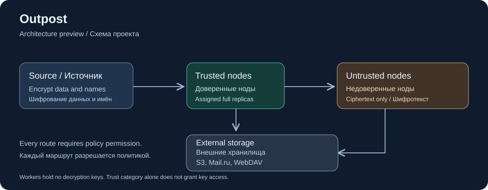

# Outpost

[Русский](README.ru.md)



Autonomous encrypted backups with complete assigned replicas, granular placement and recovery after long disconnections.

**Stage: specification and repository bootstrap.** There is no runnable backup engine or production release yet. Start with the [specification](docs/en/specification.md) and [G1-G3 feasibility gates](docs/en/roadmap.md). The previous receiver remains in [outpost-legacy](https://github.com/nd4y/outpost-legacy).

## Planned workflows

- Back up a dataset once at the source and distribute complete encrypted replicas across permitted nodes.
- Restore one retained file version independently, including when other nodes and the control plane are unavailable.
- Reconcile and repair replicas after weeks or months offline, using authorized intermediate nodes when direct links are impossible.

## Storage and privacy

Policies distinguish **trusted nodes**, **untrusted nodes** and **external storage** such as S3, Mail.ru and WebDAV. Each dataset selects permitted categories, concrete recipients and transit routes. Untrusted workers receive ciphertext without decryption keys. Trusted worker status alone grants no decryption rights. External storage is a backend, not an implicit worker.

Names and file metadata are encrypted at the source. Technical sizes, timing and block-reuse patterns are not hidden. A complete replica covers its assigned datasets and retained versions. Every cloud target must be independently complete for its assignments; eligible workers divide uploads.

## Read and check this repository

```sh
git clone https://github.com/nd4y/outpost.git
cd outpost
npm ci --prefix .standards --ignore-scripts --no-audit --no-fund
node .standards/install-gitleaks.mjs
node .standards/install-hooks.mjs
node .standards/check.mjs structure
node scripts/check-docs.mjs
node scripts/check-format.mjs
```

These commands validate documentation and the standard toolkit. They do not start a backup service. Development requires Git, Node.js 22+, npm, tar and a POSIX shell for hooks; CI pins its exact versions. Planned workers target Linux amd64/arm64. Restic 0.19.1 is the researched candidate; its suitability depends on G1-G3.

## Documentation

- [Project passport and workflows](docs/en/project.md)
- [Technical specification 1.1](docs/en/specification.md)
- [Milestones and open acceptance](docs/en/roadmap.md)
- [Development standard and commands](docs/en/development-standard.md)
- [Audit against all 45 rules](docs/en/standard-review.md)
- [Machine-readable requirement trace](docs/requirements.json)

[Repository checks](https://github.com/nd4y/outpost/actions) assess source/documentation mechanics. Product builds, releases, installation, restore and runtime acceptance remain separate. The pinned toolkit is autonomous and needs no private-repository credentials.

## Support and licensing

Track design defects and scoped proposals in [Issues](https://github.com/nd4y/outpost/issues). Use [SECURITY.md](SECURITY.md) for sensitive reports. No runtime compatibility or response-time SLA is promised at this stage. [CONTRIBUTING.md](CONTRIBUTING.md) explains bilingual PRs and owner merges.

Original project material is [MIT licensed](LICENSE). The vendored toolkit retains its [MIT notice](.standards/LICENSE). Restic and other future runtime dependencies retain their own licenses; none is bundled as a product release here.
