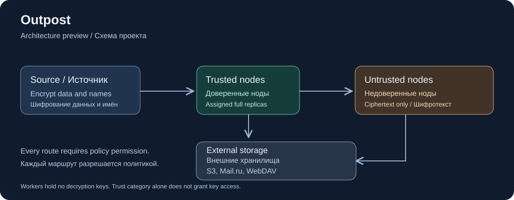

# Outpost

[English](README.md)

[Ограниченные окна проверки](docs/ru/verification-windows.md) продолжают проверку поколений между HTTPS-запросами и хеширование облачных объектов между физическими частями. Квитанции сохраняют исходное время чтения. Короткие тесты покрывают обрыв прогресса, новые операции, прежний протокол, повреждения и независимое восстановление; полная приёмка продукта и масштаба остаётся открытой.



Автономные зашифрованные резервные копии: полный назначенный состав на каждой ноде, точные правила размещения и восстановление после длительных разрывов связи.

**Стадия: M0; G1 принят, G2/G3 - кандидаты реализации.** [Формат файлового комплекта G1](docs/ru/file-kit-format.md) потоково записывает файлы в зашифрованные объекты и восстанавливает выбранную версию без общего индекса репозитория. Отдельные типы комплектов сохраняют атрибуты каталогов и символические ссылки без перехода к их целям; обычные файлы сохраняют прежний формат. Производственного сервиса пока нет. Начните с [ТЗ](docs/ru/specification.md) и [обязательных прототипов G1-G3](docs/ru/roadmap.md). Прежний приёмник сохранён в [outpost-legacy](https://github.com/nd4y/outpost-legacy).

[Протокол приёмки G1](docs/ru/g1-acceptance.md) покрывает скрытые имена, старые и новые версии, атрибуты, части описания, отказы при повреждениях, реальные границы SIGKILL и параллельное обслуживание. Физический прогон 100 ГиБ/8 МиБ прошёл все 23 фазы, включая независимое восстановление старой и новой версий после переупаковки и удаления версий. Непрерывная замена добавила 31 103 218 байт зашифрованных данных и метаданных, меньше 128 МиБ. [Ограниченный протокол](docs/g1-scale-evidence.json) указывает проверенный срез кода и затраты; G2/G3, полная приёмка продукта и рабочая выкладка остаются отдельными этапами.

Локальный CLI принимает обычные файлы источника и ключа владельца. Символьные ссылки и именованные каналы отклоняются без ожидания писателя в канале; файл ключей восстановления должен иметь закрытые права доступа. Имена результата должны укладываться в байтовые пределы Linux: 255 на компонент и 4095 на относительный путь; неподдерживаемое имя отклоняется до чтения источника.

[Кандидат поколений и реплик G2](docs/ru/generation-replicas.md) добавляет подписанные полные каталоги, приём без ключей расшифрования, сохранение прогресса, постоянные закрепления и отдельно разрешённую очистку. Компактный локальный индекс истории имеет явные команды миграции и защищённого отката; сетевые каталоги и прежние файловые комплекты сохраняют совместимость. Малые тесты на HDD покрывают переход к новой контрольной точке, перепаковку источника, реальное завершение процесса и независимое восстановление старой и новой версий. Тяжёлые проверки масштаба и длительной работы отложены; это не полная приёмка G2 и не сетевой сервис.

[Ограниченная квитанция G2](docs/g2-history-evidence.json) фиксирует180реальных обновлений по64КиБ при отключённом третьем держателе, прерванное прямое наверстывание и независимое восстановление старой и новой версий. Отдельно проверены настоящий TLS-переход эпохи, отзыв старой ветви и устойчивый запрет отката. Полный распределённый масштаб этим не принят.

[ТЗ 1.5](docs/ru/specification.md) требует параллельной передачи частей разрешённым приёмникам, пересылки до завершения поколения и освобождения снимка по заданному порогу. [Кандидат с двумя держателями](docs/ru/source-agent.md#параллельный-захват-на-два-обязательных-держателя) передаёт принятые пакеты до запечатывания, по умолчанию ждёт две проверенные полные копии и допускает явно включённое раннее освобождение, когда оба держателя приняли весь набор зависимостей или каждый принял свою часть. Воркеры могут завершить публикацию при выключенном источнике. Кандидат обновляет оба разрешения одной подписанной операцией.

[Кандидат G3](docs/ru/peer-transfer.md) добавляет push/pull по HTTPS с взаимной аутентификацией, постоянный журнал операций и публикацию полных поколений через асинхронную промежуточную ноду. Короткие проверки включают ложные подтверждения, потерю ответов, отмену параллельных чтений и самостоятельное восстановление после потери источника и промежуточной ноды. По умолчанию push полностью перечитывает цель; явная [политика повторного использования](docs/ru/readback-reuse.md) сохраняет исходный возраст доказательства и исключает скачивание неизменённых объектов. [Кандидат внешней загрузки](docs/ru/external-upload.md) добавляет S3-совместимый/WebDAV-адаптеры, три независимых воркера, сохранённые подписанные планы, возобновляемое планирование частей, передачу работы после отказа и самостоятельно восстанавливаемые поколения цели. Отдельное правило владельца включает повторное использование облачного чтения с точной привязкой дескриптора и исходным возрастом доказательства. Допуск реальных endpoint, полный учёт трафика и тяжёлая приёмка G3 остаются открытыми.

[Управляемые измерения G3](docs/g3-latency-evidence.json) сохраняют все неуспехи скорости. Для обоих протоколов подтверждено независимое восстановление старой и новой версий, но стенд с общими CPU/HDD не обеспечил устойчивые1,5x; G3 остаётся открытой.

[Квитанция idle polling](docs/upload-idle-evidence.json) отделяет проверенное сокращение запросов ожидающих воркеров и обычное автономное облачное восстановление от непройденного12-секундного теста слота на занятом общем HDD. Полная скорость G3 остаётся открытой.

Подпись S3-совместимых запросов теперь использует закреплённые SDK/протокольные компоненты с явными credentials и прежними лимитами Outpost. Независимые подписи и реальная проверка подписанной длины описаны в [адаптере хранилища](docs/ru/external-upload.md#компоненты-подписи-запросов); допуск endpoint и приёмка продукта остаются отдельными.

[Постоянная очередь загрузок](docs/ru/upload-queue.md) принимает подписанные планы, закрепляет источники и выполняет независимые цели с ограничением параллелизма, автоматическими отложенными повторами и восстановлением после падения процесса. Истёкшие и заблокированные задания остаются видимыми и защищёнными.

В [компонентах источника и восстановления](docs/ru/product-development.md) есть ограниченное сканирование с учётом всех имён жёстких ссылок, потоковый кэш только метаданных и восстановление копии/каталога без индекса состояния. [Аутентифицированный приём источника](docs/ru/source-ingress.md) добавляет воркерам допуск по текущей политике, ограниченную проверку и устойчивую очистку после подтверждения. `restore-replica` проверяет заданную контрольную точку и атомарно публикует полный выбранный результат. [Приватный агент источника](docs/ru/source-agent.md) выполняет возобновляемый захват best effort через HTTPS и подготавливает следующее подписанное поколение. [Автономная репликация](docs/ru/autonomous-replication.md) обнаруживает новые полные поколения по явным правилам владельца. [Подписанные подтверждения копий](docs/ru/copy-observations.md) позволяют дождаться двух копий через посредника с исходящими соединениями. Подготовленный провайдер принимает снимки Btrfs только для чтения с проверкой в ядре. Другие файловые системы и допуск конкретных приложений остаются в разработке.

При отдельном допуске [копия журнала источника](docs/ru/source-journal-copy.md) позволяет вернуть утраченный основной файл из точного подписанного состояния при сохранных записях захвата.

[Нативный производитель Btrfs](docs/ru/prepared-exports.md#нативный-производитель-btrfs) создаёт один снимок только для чтения на подписанную сохранённую операцию. Отдельная команда производителя принимает подписанное разрешение источника и удаляет точный подтом.

Команда `source-status` показывает срок незавершённой операции и подсказывает, можно ли её продолжить, требуется ли действие владельца или сверка с приёмником. Просроченную операцию, подготовленную локально, можно снять с подписью владельца до начала передачи.

Для активной и завершённой операции `source-status` показывает время подтверждённого освобождения представления источника и время проверки шифротекста по каждой реплике из контрольной точки. Независимую расшифровку подтверждает отдельная квитанция восстановления.

[Автоматическая замена приёмника](docs/ru/source-agent.md#автоматическая-замена-после-active) поддерживает резерв в режимах одной и двух копий. Парный захват распределяет первичные передачи по измеренной скорости, в том числе при разделённом покрытии с прямой пересылкой назначенному держателю. Перед полной публикацией воркер оценивает дополнительное место по подписанному каталогу. Если сохранились все зависимости каталога, пара публикует его повторно, а прежний слот освобождается после догоняющей репликации. [Сверка и восстановление](docs/ru/source-settlement.md) позволяют завершить принятую публикацию после истечения намерения и отличить непринятое задание от сохранённой работы приёмника.

[Просроченный захват без запечатанного каталога](docs/ru/source-settlement.md#снятие-принятого-захвата-до-запечатывания) можно снять по подписанным разрешениям владельца после сверки всех возможных приёмников. Прежний слот сохраняет временные части до допуска новой попытки с тем же номером и предшественником.

Bootstrap воркера теперь требует [допуска рабочего тома](docs/ru/runtime-volume.md). Отсутствие маркера или подмена пути останавливают работу, а открытые дескрипторы удерживают запись в допущенном дереве. Зашифрованный прогресс файла позволяет использовать принятые пакеты после падения; источник при этом читается заново. [Жизненный цикл задания источника](docs/ru/source-jobs.md) определяет реализованный порядок контрольной точки/освобождения и оставшуюся сетевую интеграцию порога копий.

[Доверенная проверка содержимого](docs/ru/trusted-verification.md) расшифровывает выбранные сохраненные версии без открытых выходных файлов и индекса реплики. Закрытый отчет сохраняет результаты по версиям и исходное время; частичная проверка возвращает ошибку. Обычные воркеры остаются без ключей расшифрования.

[Ограниченная квитанция приёма источника](docs/source-ingress-evidence.json) фиксирует однократную передачу полного каталога между несколькими пакетами проверки, прежнюю совместимость и отказы после реального истечения. Репетиция с физическим файлом 128 МиБ и восстановление обеих полных реплик в чистых потребителях подготавливают отдельный этап 100 ГиБ, не заменяя его приёмку.

[Ограниченная квитанция восстановления плана](docs/maintenance-plan-evidence.json) покрывает экспорт и точный возврат потерянного набора удаления, реальное завершение процесса, допуск остановленного воркера и выбранный CLI. Индекс и подписанный журнал разрешений должны сохраниться; одновременная потеря метаданных остаётся открытой.

## Основные сценарии

- Один раз получить данные с источника и распределить полные зашифрованные копии по разрешённым нодам.
- Независимо восстановить выбранную версию файла, включая недоступность других нод и control plane.
- Сверить и восстановить реплики после недель или месяцев отключения, используя разрешённые промежуточные ноды.

## Хранение и конфиденциальность

Политики различают **доверенные ноды**, **недоверенные ноды** и **внешние хранилища**: S3-совместимые API и WebDAV. Набор выбирает допустимые категории, конкретных получателей и транзит. Недоверенные workers получают шифротекст без ключей. Доверие к ноде само по себе не даёт права расшифрования. Внешнее хранилище не считается worker.

Имена и метаданные файлов шифруются на источнике. Технические размеры, время передачи и повторное использование блоков не скрываются. Полная реплика содержит назначенные наборы и сохраняемые версии. Облачная цель должна быть независимо полной для своих назначений; разрешённые workers делят загрузку.

## Как изучить и проверить репозиторий

```sh
git clone https://github.com/nd4y/outpost.git
cd outpost
npm ci --prefix .standards --ignore-scripts --no-audit --no-fund
node .standards/install-gitleaks.mjs
node .standards/install-hooks.mjs
node .standards/check.mjs structure
node scripts/check-docs.mjs
node scripts/check-format.mjs
```

Команды проверяют документацию и пакет стандарта. Сервис резервирования они не запускают. Для разработки нужны Git, Node.js 22+, npm, tar и POSIX shell для hooks; точные версии CI закреплены. CLI G1 предназначен для Linux и использует закреплённый chunker restic со стандартной криптографией Go. Прежний эксперимент restic 0.19.1 остаётся сравнением; целевые workers - Linux amd64/arm64.

## Документация

- [Паспорт и сценарии](docs/ru/project.md)
- [Техническое задание 1.5](docs/ru/specification.md)
- [Этапы и незакрытая приёмка](docs/ru/roadmap.md)
- [Завершение продукта и подписанная конфигурация](docs/ru/product-development.md)
- [Стандарт разработки и команды](docs/ru/development-standard.md)
- [Аудит по всем 45 правилам](docs/ru/standard-review.md)
- [Исполняемый эксперимент G1 и ограничения](docs/ru/g1-prototype.md)
- [Независимый файловый формат и выбор движка](docs/ru/file-kit-format.md)
- [Приёмка G1, пределы стоимости и команды](docs/ru/g1-acceptance.md)
- [Контракт инфраструктурного профиля](docs/ru/infrastructure-profile.md)
- [Машиночитаемая трассировка требований](docs/requirements.json)
- [Связи требований G1 с исполняемыми проверками](docs/g1-trace.json)
- [Контракты поколений и реплик G2](docs/ru/generation-replicas.md)
- [Связи частей требований G2 с проверками](docs/g2-trace.json)
- [Протокол G3, доказательства и ограничения](docs/ru/peer-transfer.md)
- [Распределённая внешняя загрузка, восстановление и ограничения](docs/ru/external-upload.md) - S3-совместимые и WebDAV-цели с ограниченными повторными проверками возможностей.
- [Отложенное архивное восстановление](docs/ru/archive-recovery.md) - извлечение выбранных частей из S3 по подписанной карте с ограничением стоимости и временным окном.
- [Автономное планирование внешней загрузки](docs/ru/delegated-upload.md)
- [Контракт повторного использования результатов чтения](docs/ru/readback-reuse.md)
- [Связи требований G3 с ограниченными проверками](docs/g3-trace.json)

[Проверки репозитория](https://github.com/nd4y/outpost/actions) относятся к исходникам и документации. Сборка, выпуск, установка, восстановление и runtime принимаются отдельно. Закреплённый пакет стандарта автономен и не требует доступа к приватному репозиторию. CI проверяет неизменную контрольную сумму сканера и при загрузке через официальный API релиза.

## Поддержка и лицензии

Замечания к проекту и ограниченные предложения принимаются в [Issues](https://github.com/nd4y/outpost/issues). Для чувствительных сообщений используйте [SECURITY.md](SECURITY.md). На этой стадии нет обещаний совместимости runtime и SLA ответа. [CONTRIBUTING.md](CONTRIBUTING.md) описывает двуязычные PR и merge владельцем.

Исходные материалы проекта распространяются по [MIT](LICENSE). В пакете стандарта сохранена его [лицензия MIT](.standards/LICENSE). Restic и будущие runtime-зависимости имеют собственные лицензии; здесь они не поставляются как готовый продукт.

Приватный агент источника поддерживает [устойчивое интервальное расписание](docs/ru/source-scheduling.md), паузу, перезапуск и продолжение незавершенного задания. Явное обновление полномочий источника сохраняет эту историю и переводит подписанный журнал в новый формат без расширения доступа. Первая установка публикует только готовый runtime, сохраняет прерванные попытки и ограничивает их число. Полная приемка продукта остается открытой.

[Кандидат API управления](docs/ru/management-api.md) поддерживает подписанную конфигурацию, устойчивые отчеты с исходным возрастом и очередь подписанных команд. Воркеры сохраняют pause/resume после перезапуска и смены политики, дожидаются завершения передач до подтверждения паузы и повторяют прежнее подтверждение при потере ответа. Повтор заблокированного задания связывает журналы воркера и загрузки устойчивым идентификатором и не запускает завершенную загрузку заново. Отдельные процессы отчетов и опроса команд независимы от исполнения бекапов. Асинхронный scrub шифротекста и отдельно подписанное обслуживание сохраняют исходные результаты после перезапуска. Подписанные отчеты передают ограниченный прогресс команд отдельно от заданий бекапа. [Разрешенный ремонт реплик](docs/ru/integrity-repair.md) сохраняет карантин и исправляет обнаруженные повреждения по существующим маршрутам push/pull. [Доверенное восстановление](docs/ru/trusted-recovery.md) и [приватный сервис управления](docs/ru/management-service.md) имеют короткие процессные проверки; [двуязычный интерфейс оператора](docs/ru/management-ui.md) имеет изолированные браузерные проверки просмотра копий, подписанной политики и точного запроса восстановления. Постоянный журнал браузера сохраняет точный повтор после закрытия вкладок и перезапуска, согласует несколько вкладок и блокирует отправку при отказе хранилища. Для ещё не принятых запросов реализован ограниченный кандидат отказа; полнота внешних хранилищ, ручная доступность и полная приёмка продукта остаются открытыми.

[Доверенное восстановление](docs/ru/trusted-recovery.md) связывает подписанные команды с приватным локальным исполнителем: отдельный допуск выходных данных, атомарная публикация, исходные квитанции и версионированные отчеты. Обычный воркер остается без ключа.

[Ремонт каталогов](docs/ru/integrity-repair.md#недоступные-каталоги) изолирует поврежденные метаданные, сохраняет доступ к исправным поколениям, удерживает исходник в карантине и восстанавливает каталог через явно разрешенные ноды.

[Команды сервиса управления](docs/ru/management-service.md) поддерживают приватную инициализацию, статус, ревизию профиля, ограниченную сверку и обслуживание по TLS. Остановка с ожиданием, потеря тома и настоящее аварийное завершение проверены на изолированных данных; это не означает рабочую установку.

Владелец может проверить и отклонить принятый запрос только до публикации эффекта. Отдельная квитанция решения и аудит сохраняют исходный запрос; повтор не может исполнить его. Опубликованные команды и долговечные эффекты конфигурации отклонить этим способом нельзя. [Контракт жизненного цикла](docs/ru/management-service.md#разрешение-неопубликованных-намерений) описывает защиту формата, сохранённый снимок и оставшуюся работу по восстановлению.

[Приватный снимок управления](docs/ru/management-snapshots.md) сохраняет административную историю и независимо проверяет выбранное состояние без запуска исторических команд.

Интерфейс показывает [наблюдения внешних копий](docs/ru/external-copy-reporting.md) с исходным временем проверки и явным неизвестным состоянием.

[Кандидат поставки Linux](docs/ru/distribution.md) собирает связанные с исходниками архивы amd64/arm64 и основу контейнера без оболочки; установка и приемка работающей среды остаются явными этапами.

[Отдельный процесс телеметрии](docs/ru/telemetry.md) использует подписанную ограниченную очередь OTLP, сохраняет позиции источника и явно обновляет разрешение на отправку. Короткие проверки включают настоящий коллектор и backup/restore при задержке отправки; полное покрытие измерений и эксплуатационная приемка остаются открытыми.

[Правила мониторинга](docs/ru/telemetry.md#правила-мониторинга-и-независимая-проверка-доставки) различают отсутствие телеметрии и измеренные сбои. Отдельная проверка следит за фактическим получением контрольного сигнала.

[Комплект восстановления владельца](docs/ru/owner-recovery-package.md) сохраняет материал расшифрования только для чтения, исходный возраст контрольной точки и выбранные автономные инструменты в приватном хранилище владельца. [Подготовка эпохи ключей](docs/ru/owner-recovery-package.md#подготовить-новую-эпоху-ключей) создаёт отдельный домен и связывает его с проверенным прежним комплектом и контрольной точкой. Допуск, вывод ключей из использования и приёмку полного масштаба проверяют отдельно.

[Завершение операции с истёкшим разрешением](docs/ru/source-settlement.md) получает только ранее сохранённую исходную квитанцию по новому допуску владельца и текущей политике приёмника. Оно сохраняет исходный возраст проверки и требование к независимым копиям. Отсутствие квитанции или истёкшее разрешение наблюдений оставляет операцию в ожидании; неизменяемое намерение записи при этом не продлевается.

[Продление разрешения приёмника](docs/ru/receiver-renewal.md) принимает новое разрешение того же объёма в существующем журнале после явного обслуживания остановленного воркера. Оно сохраняет исторические квитанции и поколения, запрещает прежние программы и использует текущую политику и дисковую квоту приёмника.

[Восстановление отсутствующей квитанции](docs/ru/receipt-recovery.md) использует отдельное новое разрешение владельца и текущую политику приёмника. Оно восстанавливает квитанцию только по уже полному поколению и неизменившимся исходным доказательствам публикации, сохраняя исходный возраст проверки и подписанный аудит. Обычная сверка остаётся отдельным шагом. Неопубликованные операции и утраченные журналы остаются в ожидании.

[Подготовленные экспорты приложений](docs/ru/prepared-exports.md) связывают подписанный полный состав нативного производителя с неизменяемой операцией источника, сохраняя исходный возраст и историю файлов. Проверки текущего/предыдущего CLI и настоящего SIGKILL включают независимое восстановление и открытие двух нативных экспортов SQLite. Для захвата снимков Btrfs только для чтения используется тот же подписанный перечень. Снимки создаёт и хранит нативный производитель.

Для целей WebDAV без условного `PUT` есть явный профиль MOVE. Воркеры сохраняют попытки загрузки, проверяют шифротекст и публикуют его с `Overwrite: F`. Процессная проверка перезапускает воркеры по обе стороны MOVE и независимо восстанавливает два сохранённых поколения. [Внешняя загрузка](docs/ru/external-upload.md).

`restore-external` восстанавливает выбранную версию файла, каталог или поколение непосредственно из S3-совместимой или WebDAV-копии с доступом только на чтение и комплектом владельца. Команда проверяет выбранную контрольную точку и атомарно публикует результат. [Независимое восстановление](docs/ru/external-upload.md#независимое-восстановление-из-внешнего-хранилища).

Остановленный worker может экспортировать связанный с индексом checkpoint метаданных и явно восстановить одновременную потерю основного индекса, журнала retention и незавершённых планов при сохранности текущей подписанной копии индекса и якоря. См. [условия и повтор после прерывания](docs/ru/generation-replicas.md#совместная-потеря-метаданных-реплики). Восстановление целого тома и приёмка всего продукта остаются отдельными этапами.

Native CI теперь подготавливает скачиваемые кандидаты разработки с явным списком файлов, выбором коммита/запуска, контрольными суммами, связанным с бинарными файлами SBOM и [примечаниями на двух языках](docs/ru/release-notes.md). [Независимая проверка скачивания](docs/ru/distribution.md#скачиваемые-кандидаты-ci) отделена от приёмки runtime и релиза.

[Проверка установки скачанного кандидата](docs/downloaded-install-evidence.json) сохраняет семь изолированных сценариев установки/обновления/отката/восстановления amd64 на настоящих CI-бинарных файлах; холодный старт хоста и боевой допуск остаются отдельными.
