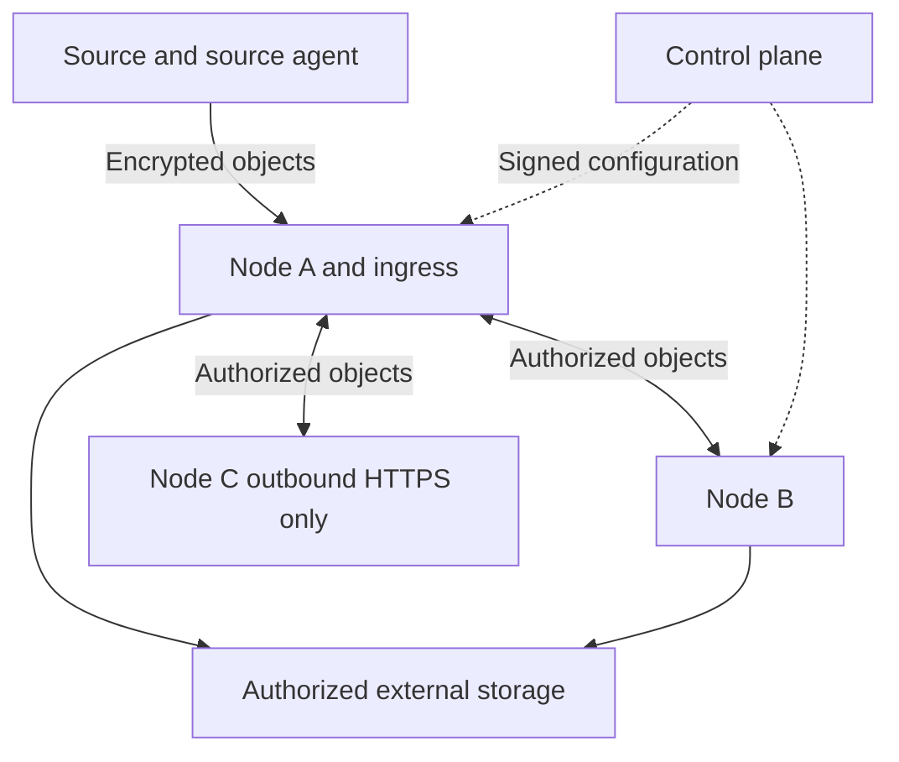

# Outpost technical specification

Version 1.1, 5 November 2026. Outpost provides autonomous encrypted backup replicas. Restic is the baseline candidate for backup and native restoration; Outpost supplies placement, transfer, replica state and operations.

A release requires all applicable mandatory requirements and acceptance scenarios. Gates G1-G3 precede format selection and implementation at scale. If restic cannot satisfy a mandatory requirement, change the adapter or engine through a recorded decision instead of dropping the requirement.

# 1 Purpose and scope

Preserve versions from NAS and other authorized sources, distribute complete assigned copies, detect corruption and repair replicas after connectivity returns. The initial design target is more than 5 TB across several sites with unreliable links.

A complete copy contains all data and metadata required to restore the datasets and retained versions assigned to that node. Placement uses trusted nodes, untrusted nodes and external storage. Assigning a category does not authorize every member of that category.

Scope includes file sources, prepared application dumps, source agents, control plane, workers, external-storage adapters, recovery, monitoring and documentation. Identifiers and isolation must accommodate future tenants.

The first version does not include a distributed editable filesystem, independent concurrent writers of one dataset, bare-metal recovery or billing. Delayed-access archive storage is a separate profile. Ordinary S3 acceptance does not establish archive readiness.

This specification defines work; it does not initiate deployment or migration of existing backups.

# 2 Terms and roles

| Term               | Meaning                                                                      |
| ------------------ | ---------------------------------------------------------------------------- |
| Source             | Device or application holding original data                                  |
| Source agent       | Trusted component obtaining a consistent source view and encrypting it       |
| Dataset            | Logical file group with selection, placement and retention policies          |
| Storage domain     | A group with the same trust, key, recipient and retention boundaries         |
| Object             | Transfer/storage unit of ciphertext with an ID, length and checksum          |
| Generation         | Consistent backup state and its complete dependency closure                  |
| Generation catalog | Signed object inventory with original names concealed                        |
| Node or worker     | Trusted or untrusted ciphertext receiver/sender without decryption keys      |
| Intermediate node  | Authorized holder that durably stores objects and forwards them later        |
| Control plane      | Management of configuration, policies, access and observed state             |
| Recovery kit       | Owner-held secrets, format information, verification keys and recovery tools |
| File kit           | Pre-created descriptor and encrypted dependencies for one file version       |
| Pin                | Protection of a generation or dependency against deletion                    |

The data owner approves trust boundaries and holds the recovery kit. Operators manage jobs within assigned rights. Maintenance/deletion authority is separate from upload authority. An untrusted node administrator controls their host without receiving data keys. Trust category is not an authorization role: ordinary workers on trusted nodes also store ciphertext only.

# 3 Architecture and component boundaries

**REQ-01. Reuse a proven engine.** Use restic for reading, chunking, deduplication, compression, encryption, snapshots and native restore. Isolate CLI/REST access behind an adapter. A normal complete replica must remain readable by an unmodified restic. Pin binaries and format versions per release; the researched baseline is restic 0.19.1. Assess upgrades separately.

Rest-server may provide the HTTPS ingress but is not a complete peer protocol. Restic copy opens repositories and must not implement keyless fan-out. Use existing SDKs/rclone for supported storage protocols. Do not develop new cryptographic primitives or a new chunking algorithm.

1. A source agent obtains a consistent view and classifies storage domains.
2. Restic encrypts on the trusted side and sends new objects to one authorized ingress.
3. A trusted component seals and signs a consistent generation.
4. Workers obtain missing ciphertext from authorized holders.
5. Eligible workers divide external-storage uploads.
6. The owner restores from a complete replica or an independent file kit on a trusted machine.

The control plane is not an obligatory intermediary for every object. Source agents never give remote workers plaintext files. Intermediate workers forward application objects without becoming general-purpose network routers.

This is a logical domain-specific exchange. Every edge must be authorized. C initiates HTTPS and obtains data in responses; the bidirectional arrow does not require inbound connections to C. External storage participates only where allowed.

Modules: source providers, restic adapter, generation catalog, policy engine, peer transport, scheduler, cloud adapters, retention controller, recovery tool, UI/API and telemetry adapter.

# 4 Sources and consistency

**REQ-02. Consistent source view.** Each source declares a provider and application, filesystem or explicit best-effort consistency level. Use available Btrfs/ZFS snapshots, supported application dumps or write-quiescing procedures, and an appropriate LVM/application provider for ext4/XFS. Verify actual source capabilities before enrollment. Reading a changing directory is not application-consistent backup.

**REQ-03. File semantics.** Preserve content, original path, type, size, supported timestamps, permissions, ACL/xattr and links according to the source profile. Unsupported mandatory attributes produce an explicitly incomplete result. Preserve symbolic links by default without following them outside approved roots. Overlapping roots, hardlinks and aliases must not bypass confidentiality policies.

**REQ-04. No second complete source copy.** Do not require a complete local repository on the NAS before upload. Allow bounded caches and temporary packs with explicit paths, quotas and exhaustion behavior. Account separately for source-snapshot space retained by ongoing modifications.

**REQ-05. One initial source transfer.** In normal operation, transfer each required new encrypted object once from the source to an ingress; workers perform fan-out. Retries are allowed and measured. Ingress failover should reuse accepted objects where possible instead of automatically rereading/resending everything.

Release the source snapshot at the policy-defined durable-acceptance point. A node being absent for months must not pin that source snapshot for months. Requiring two confirmed copies before source-snapshot release is an explicit policy. If all eligible receivers are unavailable, respect the bounded local buffer and report backup admission stopped at its limit.

# 5 Encryption and keys

**REQ-06. Encrypt at the source.** Encrypt content and confidential metadata, including names and paths, before leaving the trusted zone. Nodes and external storage receive ciphertext and technical IDs only. Plaintext names must not enter object keys, job descriptions, storage tags or shared telemetry.

Object lengths, counts, transfer times and block-reuse patterns are acceptable technical leakage for version one; hiding all sizes/access patterns is outside scope.

**REQ-07. Separate keys and authorities.** Separate data decryption keys, configuration/generation signing, deletion authority, node identities and storage credentials. Workers receive no plaintext repository key or decryption password. Encrypted native key slots may be replicated and are not plaintext secret disclosure.

Data keys stay at the source and in the owner's recovery kit. The normal control plane need not hold them. Maintenance runs in the owner's trusted zone. Use separate keys per storage domain initially; a different password for every file is not required. Changing a password does not revoke a previously disclosed master key.

**REQ-08. Independent recovery kit.** Support recovery without the source NAS, control-plane account or other nodes. Include secrets, format parameters, domain identities, public verification keys, the latest saved trusted checkpoint, tool versions and instructions. Losing the latest checkpoint limits proof of freshness without preventing decryption of an available complete version.

Never store a plaintext recovery kit beside a replica or send it to an external model. Verify rotation and kit updates by restoring retained old and new versions.

# 6 File versions and independent recovery

**REQ-09. Block-level history.** A file change creates a version reusing unchanged blocks. Restore any selected version without applying every intermediate delta. Preserve old blocks while any retained version needs them. Never reuse a nonce with changed plaintext.

**REQ-10. Independent file kit.** Pre-create a kit for every retained file version: confidential original path/attributes, a complete ordered block list, lengths, restoration parameters and integrity verification. A multipart descriptor must include all of its own dependencies.

Recovery must work when the common repository index/catalog, other generation catalogs, original device, control plane and other files' payloads are all unavailable. The owner's kit and explicitly included common format parameters are allowed. A reference to an unavailable global index is insufficient.

Versions of the same file may share stored blocks. A lost shared block affects every dependent version's status. Detect reordered parts, substituted versions, truncated final parts and blocks belonging to another file.

**REQ-11. Kits survive maintenance.** Restic's ordinary selective restore from a healthy repository does not satisfy REQ-10. Repacking and GC must preserve every retained kit's dependencies or atomically replace the kit with a verified equivalent.

G1 chooses the practical format and encrypted-block extraction path, using established mechanisms or a minimal self-contained representation. It must not require another full source-local repository. Measure storage, object count, duplication, reads and transfer costs. Keeping every old pack forever is not a GC solution.

# 7 Objects and storage limits

**REQ-12. Hard object limits.** Each adapter declares size limits, supported operations and verification methods. Transmitted size including encryption, headers and metadata must fit the actual target limit. A restic target pack-size setting alone is not proof of a hard cap.

Large source files become small encrypted packs. Further split only objects exceeding a target's limit. Preserve complete part lists, order, lengths and checksums; independent recovery must understand this transport layer.

**REQ-13. Immutable publication.** Published objects are immutable. Reject the same ID with different bytes. Incomplete uploads are never visible as complete. Acknowledge only after verification and the declared durability boundary, not after enqueueing in RAM.

Local publication must be atomic and survive power loss. Cloud acknowledgement follows the provider's actual contract with additional verification, not assumed filesystem semantics. Clean abandoned uploads separately without removing committed dependencies.

Object identity includes domain_id, object_id, length, ciphertext cryptographic checksum and transport-format version. Cleartext original names are absent.

# 8 Placement policy

**REQ-14. Classify before packing.** Apply selection on the trusted side before mixing files in packs or deduplicating. Different trust, key or placement domains use separate repositories. Do not send a mixed pack containing forbidden data to deliver an allowed file.

**REQ-15. Authorized graph.** Explicitly authorize final nodes, external storage and intermediate holders per domain. Restrictions include temporary files, caches and ciphertext in transit. Unknown nodes/targets are denied by default. No permitted path means POLICY_BLOCKED, not routing through an arbitrary holder.

| Category         | Purpose                                                             | Data and authority                                                                         |
| ---------------- | ------------------------------------------------------------------- | ------------------------------------------------------------------------------------------ |
| Trusted node     | Worker in an administratively controlled zone accepted by the owner | Assigned datasets only; decryption requires a separately authorized trusted-component role |
| Untrusted node   | Worker outside the owner's administrative control                   | Authorized ciphertext and least-privilege exchange, without decryption keys                |
| External storage | S3, Mail.ru, WebDAV or another supported backend                    | Explicitly allowed datasets and operations; no embedded Outpost worker is assumed          |

Dataset policy combines allowed categories, concrete recipient identities and separate transit permissions. These restrictions apply together. A dataset may be limited to selected trusted nodes; another may additionally permit selected untrusted nodes or external storage. Rules are independent of the type of user files.

Support paths, exclusions, dataset labels and explicit precedence. Reject unresolved overlaps before backup. Deny overrides allow. Identical content in another domain does not authorize cross-domain deduplication. Only the owner assigns trust labels.

**REQ-16. Controlled placement changes.** New recipients/accounts and lifted prohibitions require an explicit owner-authorized policy change with a preview of affected datasets, volume and recipients. Tightening stops new transfers first, then performs controlled deletion where possible. Data already sent to an untrusted party cannot be declared revoked or certainly deleted.

# 9 Configuration and autonomous jobs

**REQ-17. Pull configuration.** Workers retrieve signed configuration over HTTPS directly or through an authorized intermediate that preserves the original signature. Direct control-plane reachability from every node is not required. Configuration includes identity, domains, routes, schedules, quotas, resource limits, authority validity and protocol version. Shared jobs contain no secrets; use separately scoped credentials or local secret references.

Configuration is not arbitrary shell execution. Select providers/hooks from installed and verified implementations; update code through the release process.

**REQ-18. Operate without the center.** Persist accepted configuration, queues, progress, receipts and pins durably. Continue authorized jobs during a control-plane outage within authority validity. Local restore is independent of the center. Do not discover new authorized recipients implicitly.

Set offline validity per domain. Indefinite autonomous access and immediate global revocation during a partition cannot both be guaranteed. Expired authority stops new transfers while preserving owner access to local copies. An expired transport certificate must not prevent local recovery.

**REQ-19. Durable job journal.** Jobs carry stable operation_id, type, domain, generation, executor, attempt, expected-result checksum and state. Restart/repeated delivery must not lose accepted results or repeat unsafe deletions.

Use at-least-once delivery with idempotency; exactly-once execution is not promised. An uncertain result requires destination readback before retry. A timeout does not prove the object was never written.

# 10 Generations and writer conflicts

**REQ-20. Generation catalog.** Sign domain_id, repository_id, writer_epoch, sequence, parent checkpoint, snapshot time, policy version, format compatibility and the complete transitive object closure. Large catalogs may have verifiable parts. Catch-up must not require all intermediate catalogs.

Expose only approved technical metadata; encrypt file names, paths and attributes. A signature establishes author authority, not the truthfulness of a compromised source.

**REQ-21. One writer per epoch.** A domain has one generation author within an epoch. Source/writer failover requires a new epoch and an owner procedure. Workers persist their highest accepted epoch/sequence and do not roll back based on timestamps or storage replies.

A partitioned node unaware of a new epoch cannot reject the former writer immediately. Isolate old branches. On reconnection, do not automatically merge revoked-epoch writes into the current branch or grant them deletion authority. Conflicting signed catalogs with the same epoch/sequence produce CONFLICT.

**REQ-22. Consistent sealing.** Coordinate catalogs with backup, index changes and prune. A snapshot file or successful directory copy is insufficient; prove a consistent restorable dependency set.

Stage received objects, verify dependencies, then atomically publish COMPLETE. Interruptions preserve the previous complete version. Do not replicate locks/tmp directories as another process's live state. G2 selects consistent views, such as filesystem snapshots or immutable object representations.

Source credentials, configuration signing and deletion must not be one inseparable privilege. Creating generations alone does not authorize deletion of pinned history.

# 11 States and receipts

**REQ-23. Track readiness per target.** Track each generation, node and external target separately.

| State            | Meaning                                                   |
| ---------------- | --------------------------------------------------------- |
| DISCOVERED       | Catalog known, acquisition incomplete                     |
| TRANSFERRING     | Dependencies transferring or being verified               |
| COMPLETE         | Entire dependency closure durably present at this target  |
| CONTENT_VERIFIED | A trusted reader verified decrypted content               |
| RESTORE_VERIFIED | A defined scope was actually restored and checked         |
| STALE            | An older complete version exists and a newer one is known |
| DEGRADED         | Required replicas or assignments are unavailable          |
| CORRUPT          | A dependency failed integrity verification                |
| POLICY_BLOCKED   | Policy/topology prevents progress                         |
| CAPACITY_BLOCKED | Insufficient space without deleting protected data        |
| CONFLICT         | Incompatible authority or generations detected            |

Receipts identify target, generation, verified scope/digest, verification type, observation time and executor. An untrusted host can lie about persistence; a signed receipt is not independent readback. Show receipt age and verification level.

Global status compares actual confirmations with required assignments. One upload, restic exit code, HTTP 200 or error-free worker does not certify all replicas.

# 12 Replication across partial connectivity

**REQ-24. Complete autonomous replicas.** Each assigned node holds all dependencies of retained generations, including file kits. Restore from that node and the owner kit with all other nodes unavailable. A set of shards requiring several nodes does not qualify.

**REQ-25. Durable intermediates.** Support an authorized graph rather than all-to-all connectivity. In the test topology, C initiates outbound HTTPS only to A; B reaches A separately and cannot directly reach C. C needs no VPN. A durably stores authorized objects and forwards them independently of the original sender. Check each node's category and transit rights per domain.

Support non-overlapping connectivity windows, first source-to-intermediate and later intermediate-to-recipient. Losing the only bridge stops newer versions without invalidating complete old copies. Fail over only to a previously authorized route. A trusted-only domain must never transit an untrusted node, even with end-to-end encryption.

**REQ-26. Catch-up after absence.** Verify trusted checkpoints and obtain every missing dependency of the current retained generation without replaying every missed version. Preserve the old complete version until the new one is confirmed. If no current generation survives anywhere, do not report successful synchronization.

The test horizon is 180 days offline. A simulated sequence of 180 daily generations tests logic, not real elapsed-time endurance. During a partition, say “latest known complete version,” not globally newest.

# 13 Distributed external-storage upload

**REQ-27. Divide upload work.** Assign immutable objects to workers authorized both to hold the domain and to use the target. Normally one active executor handles an object; uncertain outcomes may cause safe duplicates. Different workers may upload parts of one large file concurrently.

Consider verified local objects, availability, bandwidth, quotas, failures and progress. Never move restricted data to a forbidden worker for bandwidth. Reassign failed work to eligible holders; one slow worker must not stop independent jobs.

Central assignment may optimize work, but durable rules and worker coordination must allow authorized work/reassignment while the center is unavailable. Arbitration may permit duplicates without byte substitution, deletion of protected objects or false COMPLETE. No permanently online coordinator is required per upload.

**REQ-28. Storage adapters.** The first functional release supports local node storage, S3-compatible storage, WebDAV and a separately verified Mail.ru route. Publish capabilities for size/object count, ranges, resume, conditional writes, atomic publication, checksum, listing, rate limits and deletion.

Do not assume WebDAV offers S3 operations or that its ETag is a content hash. Without conditional writes, use unique attempt identifiers and safe immutable publication. Unknown stream length must not create a hidden complete temporary source-file copy.

**REQ-29. Complete assigned cloud scope.** An external target contains all dependencies of its assigned domains and retained generations. Workers divide one complete target copy, not an arbitrary unrestorable sample. Exclude datasets forbidden from external storage or that specific target before creating upload tasks.

**REQ-30. Archive profile.** Glacier and delayed-access classes have separate hot-metadata, retrieval initiation/waiting, cost, availability-window and expiry/retrieval behavior. Ordinary S3 acceptance does not close this profile. Mark it unavailable until accepted and never advertise an ordinary-storage RTO for it.

# 14 Retention and garbage collection

**REQ-31. Protect local history.** Define retained versions, replica minimums and pins per domain. Keep at least the latest complete restorable generation until a replacement is complete or the owner explicitly decommissions the dataset. Calendar retention expiry while offline does not remove this pin.

Never delete last-good to make room for an incomplete replacement. Enter CAPACITY_BLOCKED with the required space. Finite disks do not promise unlimited history.

**REQ-32. Separate deletion authority.** Distinguish creating backups, logically expiring a version, repacking and physical deletion. Source credentials do not destroy past history. Use supported append-only/immutable mechanisms according to target capabilities.

**REQ-33. Safe GC.** Keyless workers must not discover semantic dependencies by running prune. Delete only with verified maintenance authority and no reference from any locally protected complete generation, file kit, active restore or valid unfinished reception.

Native maintenance runs in a trusted component over a controlled repository view. Publish its result as a new verified generation first. Preserve old physical dependencies for pinned views even when a new index uses different packs. A normal restic lock does not coordinate disconnected replicas.

An offline node does not indefinitely block all other nodes' local cleanup. Each protects its own views; unknown state is not proof of no references or permission to delete the last known copy. External targets maintain their own pins.

Persist deletion receipts and checkpoints. After journal loss, rebuild protected references before allowing GC. Receive/repack/delete races must never remove a published kit dependency.

# 15 Integrity and repair

**REQ-34. Two verification levels.** Keyless nodes verify ciphertext length and cryptographic checksums on reception and scheduled scrubs. Trusted components verify format, decryption and contents. Existence checks are not full content checks.

**REQ-35. Repair damaged objects.** Mark dependent generations/kits accordingly. Fetch a verified object from an authorized holder into staging, validate it and publish the replacement. Do not propagate damaged bytes as a new correct version.

If all surviving copies are lost or corrupt, report unrecoverable loss and affected versions. Never invent missing data or hide it by excluding a file. Separate suspected media failure from one successful object repair.

# 16 Recovery and management interface

**REQ-36. Recovery workflows.** Support a selected file/version, directory, entire dataset, complete replica without the source, independent file kit without the repository, and external-storage recovery. Never silently replace a chosen version with a newer or incomplete one.

Restore to a separate destination; overwriting existing files requires an explicit choice. Interrupted partial files must not appear successfully restored. Verify length, content and mandatory attributes. Supply an offline recovery tool, instructions and compatibility list.

**REQ-37. Management UI/API.** Show sources, datasets/domains, assignments, authorized routes, external targets, generations, queues, actual coverage, receipt age, errors and space. Separate last backup creation, each target's completeness and last verified restore.

Preview placement changes by data volume and route. Recovery selects dataset, file, version, available copy source and destination. Explain unavailable bridges, quotas and sources concretely.

**REQ-38. Roles and tenants.** A first installation may have one owner, but separate tenant_id, domain_id, repository namespaces, credentials and quotas. Matching file names, hashes or paths never grant cross-domain access. Full tenant self-service and billing are separate work.

# 17 Installation and component security

**REQ-39. Worker isolation.** Ship Linux amd64/arm64 workers without shell or package manager, non-root, read-only root filesystem, no extra capabilities, TUN, host networking or arbitrary mounts. Permit only designated data, journal, temporary and telemetry paths. Source snapshot privileges are a separate profile from keyless receivers.

A minimal bootstrap checks prerequisites, fetches a verifiable image version, creates directories and enrolls the node. It receives no perpetual source key and makes no network changes outside its declared profile.

**REQ-40. Network authorization.** Use authenticated HTTPS with domain/operation scoping. Outbound-only nodes require no inbound forwarding. Preserve other sites' network isolation; separately describe and verify any ACL expansion needed for peer exchange.

A token grants no arbitrary filesystem, destination or command access. Validate approved endpoints against redirects and name substitution. Reject invalid signatures, domains, sizes and digests before publication.

Scope external credentials to namespaces/operations. Never distribute broad Mail.ru account secrets to untrusted nodes for parallelism. If a provider cannot delegate scoped or per-upload access, only trusted holders or a separately accepted gateway handle that target. Reflect this restriction in the eligible worker count.

**REQ-41. Upgrades.** Pin image/tool versions and digests; version local schemas and protocols. Before format changes, define offline-node compatibility, rollback and old-generation recovery. A migration must not destroy the only restorable representation.

Do not approximately interpret unknown catalogs. Preserve existing complete data and request an upgrade. Never automatically delete/reinitialize state after a format error.

# 18 Observability and operations

**REQ-42. Durable telemetry.** Use Alloy or an adapter compatible with the push telemetry scheme. Persist log positions and outbound queues across restart. Metrics-server failure must not stop backup. Telemetry exhaustion follows an explicit separate policy and never deletes backup data.

Measure source-read bytes, new unique bytes, actual transferred/duplicate bytes per route, objects, completed-transfer throughput, replication lag, queues, space, complete-version/verification age, checksum and restore failures. Coverage uses a domain's required assignments, not all source data.

**REQ-43. Audit trail.** Persist policy changes, credential issuance, epoch transitions, publication, pins, GC and restores with actor, time, reason, operation_id and result. Exclude secrets, recovery kits, content and plaintext sensitive paths.

Alert on meaningful state changes: lost complete copy, lag beyond RPO, corruption, no authorized route, quota exhaustion or failed verification. Do not repeat identical notices every reconciliation cycle.

**REQ-44. Capacity and limits.** Include current data, history, pins, metadata, file kits, temporary transfers and free reserve in capacity planning. Show logical and physical space per node. Reject or clearly mark infeasible placement; configuration acceptance does not prove free capacity.

Configure CPU, RAM, cache, disk and bandwidth limits. Overload slows or pauses new work while preserving completed data. Detecting a small file change may require rereading the whole file; network savings do not promise equivalent disk-read savings.

# 19 API and data contracts

**REQ-45. Versioned interfaces.** Publish management OpenAPI and a peer-protocol specification before implementing them. Endpoint paths are design choices; operations must cover:

| Group       | Required operations                                                                       |
| ----------- | ----------------------------------------------------------------------------------------- |
| Management  | Enrollment, configuration retrieval, capability updates, revocation, audit                |
| Generations | Announce catalogs, fetch checkpoints/inventories, confirm local completeness              |
| Objects     | Presence, fetch, transfer, digest and durable-write acknowledgement                       |
| Jobs        | Obtain/compute assignment, progress, retry, failure, safe reassignment                    |
| Recovery    | Version selection, inventory verification, file-kit retrieval, trusted restore and result |
| Storage     | Pins, GC plans, deletion acknowledgement and quota state                                  |

Use stable IDs, tenant/domain scope, schema versions and validation. Critical requests carry operation_id. Clocks aid observation but do not replace signatures and epoch/sequence. Distinguish temporary failure, authorization, policy prohibition, corruption, capacity and format errors.

**REQ-46. Recovery compatibility.** Every accepted format has reference fixtures, documented dependencies and an independent reader. Test native restic recovery from a materialized full replica separately from file-kit recovery. Neither a vendor service nor a live control-plane account may be needed to read saved data.

# 20 Acceptance environment

These are initial reproducible test targets, not measured product guarantees. Version the environment and record changes before repeating acceptance.

| Parameter               | Target                                                                                                                                       |
| ----------------------- | -------------------------------------------------------------------------------------------------------------------------------------------- |
| Topology                | One source, full holders A/B/C; C only initiates HTTPS to A, with no direct B-C connection                                                   |
| AT-14 extension         | Add holder D; A/B/D can reach the target. C still has no direct external-storage route                                                       |
| External targets        | Controlled S3 and WebDAV environments; a separate actual Mail.ru route test                                                                  |
| Offline horizon         | Simulate 180 daily generations including maintenance/policy changes                                                                          |
| Authority lifetime      | At least 187 days for the long-offline scenario; expiry/renewal tested separately                                                            |
| Change fixture          | One incompressible 100 GiB file in a dedicated dataset; 8 MiB replacement, scattered edits and insertion                                     |
| Contiguous-edit traffic | At most 128 MiB of new data/metadata to each already-current target for one contiguous 8 MiB replacement, without failures or format changes |
| Unchanged repeat        | No new payload objects; metadata records/requests may occur                                                                                  |
| Source temporary disk   | Explicit quota; example 2 GiB, without growth proportional to original file size                                                             |
| Connectivity recovery   | Discover an available authorized route and start work within 60 seconds on the healthy testbed                                               |
| Executor failover       | Another eligible executor starts within 120 seconds when connectivity/resources permit                                                       |
| Parallel upload         | At least three workers complete distinct objects concurrently; at least 1.5 times single-worker throughput without a shared bottleneck       |
| Free reserve            | Configurable; test profile uses 20 percent                                                                                                   |
| Faults                  | Network cuts, process termination, testbed power loss, full disk, incorrect clocks/signatures and corrupted objects                          |

Measure scattered edits/insertion independently; the contiguous-edit bound does not automatically apply. Repacking or transforming a file may change most source bytes.

Set RPO/RTO per dataset/target after measuring size and links. Transfer time is bandwidth-limited; disconnected nodes cannot receive updates without a permitted temporal path. Archive RTO is separate.

Builds/heavy tests use isolated infrastructure under the owner's private execution profile. Synthetic tests do not replace real source, provider-limit and full-scope restore acceptance.

# 21 Mandatory architecture gates

**G1. Independent file kit.** Prove REQ-10/11 before freezing the format. On a clean machine, retain only the owner kit and a pre-created selected-version kit. Remove global index/catalog/cache and other file payloads. Restore bytes/attributes; repeat after a new version, repack, retention deletion and interrupted descriptor update.

Determine format, block extraction, reader, reuse and disk/traffic cost. Temporarily reconstructing the whole repository or using the source does not pass. An adapter remains unproven until demonstrated.

**G2. Generations and maintenance.** Demonstrate sealing during backup/prune, preservation of actual pinned dependencies and file kits, and catch-up of an outdated node. Signed deletion permission does not replace reference/pin checking.

**G3. Transfer and publication.** Demonstrate that repeated cuts, duplicate jobs, false acknowledgements and partially visible cloud objects never publish an incomplete generation. Preserve a previous complete version or a precise error, never false success.

Deliver reproducible scenarios, code version, limitations, measurements and an engine decision. If mandatory requirements are impractical with restic, record a changed technical approach instead of silently excluding them.

# 22 Acceptance scenarios

| ID    | Scenario                                          | Success criterion                                                                                                                                                                                        |
| ----- | ------------------------------------------------- | -------------------------------------------------------------------------------------------------------------------------------------------------------------------------------------------------------- |
| AT-01 | Initial backup and three full replicas            | Source sends payload to one ingress; all three nodes independently restore; no second complete repository on the source                                                                                  |
| AT-02 | Replace 8 MiB in a 100 GiB file                   | Meet section 20 traffic limits; restore old/new bytes; measure source reads and temporary space                                                                                                          |
| AT-03 | Insert, scattered edits, rename, unchanged repeat | Correct versions, measured costs, no unnecessary payload copies for same-domain rename/repeat                                                                                                            |
| AT-04 | Independent file kit                              | Offline clean-machine recovery with attributes, without global index/cache/other payloads; kit existed before removal                                                                                    |
| AT-05 | Tampered or truncated kit                         | Detect missing last part, order/version/descriptor substitution and extra bytes; no partial success                                                                                                      |
| AT-06 | Confidentiality and physical placement            | Synthetic plaintext/name markers absent from peer/storage views; forbidden ciphertext never reaches disallowed targets or intermediate disks                                                             |
| AT-07 | Bridge-only connectivity                          | C uses outbound HTTPS to A; B cannot reach C; asynchronous transfer windows work with source offline                                                                                                     |
| AT-08 | Only bridge lost                                  | Old full copies restore; new version is not marked delivered; no forbidden bypass                                                                                                                        |
| AT-09 | Return after 180 generations                      | Catch up after other nodes' maintenance/GC without replaying every version; preserve local last-good until replacement                                                                                   |
| AT-10 | Interrupt every publication step                  | Restart exposes old or new complete generation; missing dependency never yields COMPLETE                                                                                                                 |
| AT-11 | GC during pins/restore                            | Protected/unknown references survive; an absent node does not indefinitely block independent local cleanup                                                                                               |
| AT-12 | Native repack/prune                               | Pinned views and kits restore; delete old physical dependencies only after all references are released                                                                                                   |
| AT-13 | Corruption and total loss                         | Repair from an allowed verified peer; total loss is explicit with affected versions                                                                                                                      |
| AT-14 | Three parallel cloud workers                      | Distinct concurrent completed objects, profile throughput and complete final target                                                                                                                      |
| AT-15 | Worker failure and duplicate job                  | Meet failover target on a healthy testbed; immutable bytes preserved; partial upload never ready                                                                                                         |
| AT-16 | Provider boundaries                               | Test limits, multipart objects, timeouts, throttling and incomplete listings; validate Mail.ru separately                                                                                                |
| AT-17 | Control-plane outage and worker restart           | Durable queues/pins, continued authorized work, no unknown recipient; local restore independent                                                                                                          |
| AT-18 | Authority expiry/rotation                         | Stop expired new transfers, preserve local restore; old/new data readable with the appropriate kit                                                                                                       |
| AT-19 | Policy conflict/change                            | Overlaps, links and aliases cannot bypass denial; expansion requires owner authority; no false deletion claim for an offline untrusted host                                                              |
| AT-20 | Old writer/replay/bad clocks                      | Reject known rollback, isolate conflicting branches and prevent old commands deleting current data                                                                                                       |
| AT-21 | Compromised source credentials                    | Authorized new backups possible without destroying protected history; reject forged deletion plans                                                                                                       |
| AT-22 | Full disk/process/power loss                      | Last-good and journal survive; no false durable acknowledgements; resume within quotas                                                                                                                   |
| AT-23 | Source consistency/metadata                       | Restore mandatory attributes and a usable application dump; no hidden best-effort downgrade                                                                                                              |
| AT-24 | Independent native restoration                    | Ordinary restic restores a materialized replica with kit while source, center and peers are off                                                                                                          |
| AT-25 | Isolation/install/upgrade                         | Verify amd64/arm64, no shell/extra capabilities/TUN/host network, scoped mounts and no destructive format reset                                                                                          |
| AT-26 | Telemetry failure                                 | Preserve acknowledged queues within policy across outage/restart; telemetry exhaustion cannot delete backups; no secret/name leakage                                                                     |
| AT-27 | Domain/tenant separation                          | Identical names/content never bypass boundaries; credentials and prefixes isolated                                                                                                                       |
| AT-28 | Archive storage                                   | Retrieve, wait, restart and repeat after expiry; hot metadata available; restored bytes match                                                                                                            |
| AT-29 | All eligible receivers unavailable                | Source respects temp quota, claims no accepted copy and holds/releases snapshot according to explicit policy                                                                                             |
| AT-30 | Operational end-to-end run                        | Combined source changes, failures, delays, maintenance and restore; report per-target coverage and unmet conditions                                                                                      |
| AT-31 | UI and CLI                                        | Three workflows, roles, offline/error/empty states, both languages, keyboard/focus/contrast/zoom/narrow screens, Unicode paths, cancellation and exit codes; automated and manual accessibility evidence |
| AT-32 | Untrusted input/overload                          | Reject path/link/namespace/URL bypass, excess sizes/depth, slow requests and replay floods within limits; no secrets exposed; safe cancellation available                                                |
| AT-33 | Compatibility/migration                           | Upgrade oldest supported version, interrupt/recover migration, test API consumer, old backup, CLI configuration and declared architectures                                                               |
| AT-34 | Release/clean installation                        | Download real artifacts, verify sums/provenance, install, upgrade and restore; match version/commit, licenses, SBOM, bilingual instructions and support                                                  |
| AT-35 | Alerts/runbooks                                   | In an authorized test environment verify event, delivery, recovery, quiet unchanged state and monitoring failure; exercise runbook/rollback without treating stale telemetry as health                   |

All results identify tested commit/artifact, environment, commands, observed scope and remaining limitations. Use synthetic or separately approved data and an authorized isolated environment for load tests under the owner's private execution profile. A component test does not establish end-to-end recovery. Requirements cannot pass through a count of tests or a task-completed flag.

# 23 Milestones and deliverables

| Milestone | Deliverable                                                                     | Completion                                                                         |
| --------- | ------------------------------------------------------------------------------- | ---------------------------------------------------------------------------------- |
| M0        | G1-G3, file-kit format, generations/GC model and cost measurements              | Prove restic plus adapter or accept another approach while preserving requirements |
| M1        | Source providers, domains, encryption/history, recovery and file kits           | AT-02-AT-05 and AT-23; actual restoration, not backup creation alone               |
| M2        | Durable jobs, HTTPS peers, intermediates, complete generations, pins and repair | AT-01, AT-07-AT-13, AT-17, AT-20-AT-22, AT-24 and AT-29                            |
| M3        | S3, WebDAV, Mail.ru, distributed jobs and placement                             | AT-06, AT-14-AT-16, AT-18, AT-19 and AT-27                                         |
| M4        | UI/API, installation, upgrades, telemetry, documentation and measured limits    | AT-25, AT-26 and AT-30-AT-35 plus all applicable main workflows                    |
| M5        | Delayed archive recovery                                                        | AT-28 plus affected integrity, maintenance and restore regression checks           |

Deliver source, build definitions, versioned contracts, fixtures, isolated test scenarios, user/recovery/operator instructions, licenses and dependency notices. Distinguish source verification, builds, releases, installation, runtime and operations. M0 completion is not a finished system; ordinary storage release does not certify M5. Existing-data migration is separately planned and authorized.

# 24 Pilot configuration

| Area       | Must be determined                                                                       |
| ---------- | ---------------------------------------------------------------------------------------- |
| Sources    | Datasets, volume/file count, snapshot providers, applications and mandatory attributes   |
| Sites      | Identity, trust, CPU architecture, RAM, space, load budget and connectivity windows      |
| Network    | Authorized HTTPS/optional VPN directions, sole bridges and alternate routes              |
| Policies   | Retention, durable receipts before source-snapshot release, RPO/RTO and offline validity |
| Storage    | Actual accounts/endpoints, limits, API/egress cost, scoped credentials and archive class |
| Recovery   | Owner-kit custodian, alternate trusted machine and real restore acceptance scope         |
| Operations | Meaningful-notice recipients and placement/deletion authority                            |

Choose exact values before pilot acceptance. Unknown facts are not replaced with assumed capability. Go is the initial server/worker direction; use a transactional durable journal or an equivalent design proven under crash tests. Select standard signing implementations and the final adapter/format through M0. Runtime dependencies and compatibility matrices are versioned deliverables.

# 25 Development quality and standard conformance

Apply Development Standard 0.4.0 using the pinned public toolkit. Profiles: web, cli, library, service, network, integration, infra, monitoring, data and docs. Mobile, ML and firmware are outside current scope.

**REQ-47. Explicit requirement contract.** Every REQ is MUST. Scope follows its named component/profile. Each requirement blocks release of that profile until its acceptance scenarios pass; G1-G3 additionally block M0 and format freeze. Public-repository safety, secrets, bilingual docs and CI apply before initial publication and every later PR. The requirements.json catalog maps IDs, scope, stage, milestones and tests. An inapplicable archive profile is not ready. Exceptions identify rule, scope, risk, owner, compensation and review date.

The passport defines three workflows: create/distribute a protected copy, restore a selected version, and recover a replica after disconnection. Each has actor, input, expected result and acceptance. Data owner, operator, node administrator and maintenance component have separate rights. Git is the normative source; Russian/English specifications, ID catalog and published overview are reconciled on change. Private operational journals and task history stay private.

**REQ-48. Validate untrusted input.** Validate API/configuration/catalogs/objects/recovery paths/provider replies before use. Bound endpoint sizes, deadlines, concurrency and memory. Reject path/link escapes, namespace confusion, excessive depth/decompression, unauthorized URLs and redirected destinations. Never disable authorization or TLS to recover availability. Management overload must not prevent safe cancellation.

**REQ-49. Accessible interface.** UI/CLI explain purpose, next step and actual job state. UI supports Russian/English, keyboard, visible focus, labels, contrast, zoom and narrow screens toward applicable WCAG 2.2 AA criteria. Separate loading, empty, forbidden, offline, stale and error states. Long jobs show measured progress and supported cancel/resume. Irreversible actions show target, amount and consequences; repeats cannot duplicate their effect. Test CLI Unicode/spaced paths, exit codes and interrupts. Supplement automated accessibility checks with manual use.

**REQ-50. Compatibility and migrations.** Before release, declare OS/architecture/browser/restic/API/schema/format support. Version API/config/export contracts and supply a consumer example. Incompatible changes require migration/recovery paths, a support end date and old-backup verification. Test oldest-supported upgrade, interrupted migration, restored state and actual workflows. Binary rollback alone is not a schema rollback.

**REQ-51. Verifiable release.** Pin dependencies, tools and CI actions. Untrusted PRs receive no secrets/internal infrastructure. Link version, commit, artifacts, SHA256, bilingual instructions/changelog and licenses; provide SBOM/provenance where supported. Test download, clean install, upgrade and isolated restore using distributed artifacts. Provide SECURITY, support and vulnerability handling. Source, build, publication, installation, runtime and operations have separate acceptance states.

**REQ-52. Verified operations chain.** Enrollment, connectivity loss, full disk, corruption, revocation and recovery runbooks define preconditions, target, steps, success and rollback. Alerts specify trigger, recipient and action; verify delivery, recovery and quiet unchanged states. Critical operation includes independently detecting monitoring failure. Send test notifications only in authorized test environments. Stale telemetry never means zero load or health.

**REQ-53. Measured limits and costs.** Acceptance profiles define data/file/object count, concurrency, CPU/RAM/disk, queues, API/egress costs, RPO/RTO and reliability window. Unknowns have an owner and milestone: measurement plan at M0, results before the relevant release. Do not substitute arbitrary values or extrapolate one testbed to all deployments. Choose scaling changes through reproducible performance/cost comparisons.

Check REQ-47 structure/traceability on every PR; AT-31-AT-35 cover REQ-48-REQ-52 alongside original scenarios. REQ-53 extends AT-02, AT-14, AT-22 and AT-30. M1-M5 preserve M0 gates. Maintain a bilingual audit of all 45 standard rules distinguishing document coverage from product verification.

# 26 Primary references

- [Restic pack format](https://restic.readthedocs.io/en/stable/100_references.html#pack-format)
- [Restic read/write ordering](https://restic.readthedocs.io/en/stable/100_references.html#read-and-write-ordering)
- [Restic restoration](https://restic.readthedocs.io/en/stable/050_restore.html)
- [Restic retention and prune](https://restic.readthedocs.io/en/stable/060_forget.html)
- [Rest-server](https://github.com/restic/rest-server)
- [Restic repository backends](https://restic.readthedocs.io/en/stable/030_preparing_a_new_repo.html)
- [Restic tuning](https://restic.readthedocs.io/en/stable/047_tuning_parameters.html)
- [Rclone Mail.ru backend](https://rclone.org/mailru/)
- [Restic cold-storage FAQ](https://restic.readthedocs.io/en/stable/faq.html#are-cold-storages-supported)
