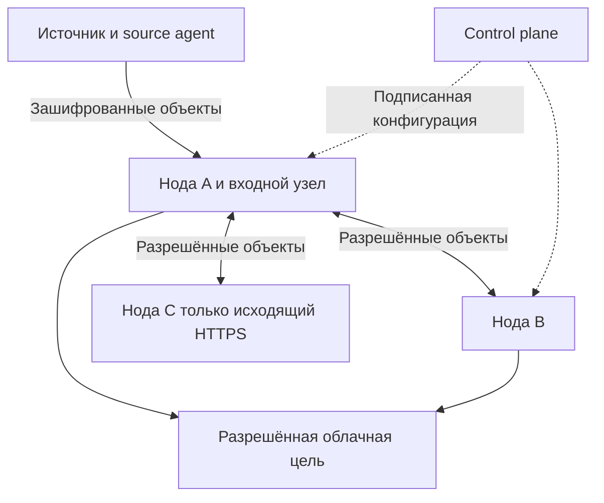

# Техническое задание Outpost

Версия 1.1 от 5 ноября 2026 года. Назначение документа - разработка и приёмка Outpost, системы резервного копирования с автономными зашифрованными репликами. Базовый кандидат для создания и восстановления копий - restic. Outpost отвечает за размещение, передачу, состояние реплик и эксплуатацию.

Выпуск считается готовым после выполнения всех обязательных требований и сценариев приёмки. Архитектурные проверки G1-G3 предшествуют закреплению формата и реализации основного объёма. Если проверка показывает несовместимость restic с обязательным требованием, меняется адаптер или базовый движок, а не само требование.

# 1 Назначение и границы системы

Outpost должен сохранять версии данных с NAS и других разрешённых источников, распределять полные копии по назначенным нодам и выбранным облакам, обнаруживать повреждения и восстанавливать реплики после возвращения связи. Исходный ориентир - более 5 ТБ данных, несколько домашних или серверных площадок и нестабильные внешние каналы.

Полная копия на ноде означает все данные и метаданные, необходимые для восстановления назначенных ей наборов и сохраняемых версий. Размещение задаётся политикой набора: доверенные ноды, недоверенные ноды и внешние хранилища. Назначение набора одной категории не разрешает автоматически передачу всем её участникам.

В объём входят файловые источники, подготовленные дампы приложений, source agent, control plane, worker, облачные адаптеры, восстановление, мониторинг и документация. Интеграция с будущими арендаторами учитывается в идентификаторах и изоляции.

В первую версию не входят распределённая файловая система для редактирования рабочих данных, согласованная запись одного набора несколькими независимыми источниками, восстановление всего компьютера на чистое оборудование и платёжная система. Glacier относится к отдельному профилю с отложенным восстановлением; готовность обычного S3 не означает его готовность.

Подготовка этого ТЗ не запускает разработку, перенос существующих копий или изменение рабочих систем.

# 2 Термины и роли

| Термин             | Значение                                                                                                  |
| ------------------ | --------------------------------------------------------------------------------------------------------- |
| Источник           | Устройство или приложение с исходными данными                                                             |
| Source agent       | Доверенный компонент на стороне источника, который получает согласованный срез и выполняет шифрование     |
| Набор данных       | Логическая группа файлов с правилами отбора, размещения и хранения                                        |
| Домен хранения     | Группа с одинаковыми границами доверия, ключами, разрешёнными получателями и политикой хранения           |
| Объект             | Неделимая единица хранения и передачи зашифрованных данных с идентификатором, длиной и контрольной суммой |
| Поколение          | Согласованное состояние резервной копии и полный набор его зависимостей                                   |
| Каталог поколения  | Подписанное описание объектов, необходимых для поколения; оригинальные имена скрыты                       |
| Нода или worker    | Доверенный или недоверенный получатель и передатчик зашифрованных объектов без ключей расшифрования       |
| Промежуточная нода | Разрешённый держатель объектов, который сохраняет их и позже передаёт дальше                              |
| Control plane      | Управление конфигурацией, политиками, доступом и наблюдаемым состоянием                                   |
| Закрепление версии | Запрет удалять её зависимости до выполнения условий освобождения                                          |
| Комплект файла     | Самодостаточные описание и зашифрованные части одной версии файла                                         |
| Recovery kit       | Независимо сохранённые ключи и сведения, необходимые владельцу для восстановления                         |

Владелец данных утверждает границы доверия и хранит recovery kit. Оператор управляет заданиями в пределах выданных прав. Полномочия обслуживания и удаления отделены от полномочий загрузки новых копий. Администратор недоверенной ноды управляет своим хостом, но не получает ключи данных. Категория доверия не заменяет отдельные полномочия: обычный worker на доверенной ноде также хранит только шифротекст.

# 3 Архитектура и повторное использование

**REQ-01. Готовый движок.** Использовать restic для чтения, разбиения на блоки, дедупликации, сжатия, шифрования, создания снимков и штатного восстановления. Обращение через CLI и REST должно быть отделено интерфейсом адаптера от логики Outpost. Формат штатной полной реплики должен оставаться совместимым с обычным restic. Версии бинарников и формата фиксируются в выпуске; текущая исследованная база - restic 0.19.1. Обновление проверяется отдельно.

rest-server может быть базой входного HTTPS-приёмника. Нельзя считать его готовым протоколом обмена между нодами. Команда restic copy требует доступа к содержимому репозиториев и не используется на нодах без ключей. rclone и готовые SDK используются для поддерживаемых облачных протоколов. Свои криптографические примитивы и собственный алгоритм разбиения файлов не разрабатываются.

Поток данных:

1. Source agent получает согласованный срез и определяет домены хранения.

2. restic на доверенной стороне шифрует данные и передаёт их на один разрешённый входной узел.

3. Доверенный компонент формирует и подписывает согласованное поколение.

4. Workers получают недостающие зашифрованные объекты у разрешённых держателей.

5. Разрешённые workers распределяют отправку объектов в облачные цели.

6. Восстановление выполняется на доверенной машине владельца из выбранной полной реплики или автономного комплекта файла.

Control plane не является обязательным посредником для каждой передачи. Source agent не отдаёт удалённым workers открытые файлы. Промежуточный worker работает на уровне объектов приложения и не становится универсальным сетевым маршрутизатором.

Схема показывает логический обмен для одного домена. Каждый маршрут должен быть разрешён его политикой. Двунаправленная линия не требует входящего соединения к C: C сам инициирует HTTPS и забирает данные ответами на запросы. Облако участвует только в тех доменах, где оно разрешено.

Граница модулей: source providers, адаптер restic, каталог поколений, policy engine, peer transport, scheduler, cloud adapters, retention controller, recovery tool, UI/API и telemetry adapter.

# 4 Источники и согласованность

**REQ-02. Согласованный срез.** Для каждого источника задаётся provider и уровень согласованности: приложение, файловая система или best effort. Btrfs/ZFS используют доступный снимок; базы данных - поддерживаемый дамп или процедуру остановки записи; для ext4/XFS применяется подходящий LVM/application provider. Возможности конкретного NAS проверяются до подключения. Обычное чтение изменяющегося каталога не маркируется как согласованная копия приложения.

**REQ-03. Учёт файлов.** Копируются содержимое, исходный путь, тип, размер, поддерживаемые временные атрибуты, права, ACL/xattr и связи согласно профилю источника. Обязательные, но неподдерживаемые атрибуты приводят к явному неполному результату. Символические ссылки по умолчанию сохраняются как ссылки без перехода за пределы разрешённых корней. Пересечения корней, жёсткие ссылки и псевдонимы путей не должны обходить правила конфиденциальности.

**REQ-04. Без второй полной копии на источнике.** Запрещено требовать на NAS полный локальный репозиторий для последующей отправки. Допускаются ограниченные кеш и временные пакеты. Для них задаются каталоги, квоты и поведение при заполнении. Рост места, удерживаемого файловым снимком из-за изменения исходных данных, учитывается отдельно.

**REQ-05. Однократное первоначальное получение.** При штатном создании поколения источник один раз передаёт необходимые новые зашифрованные объекты первому получателю. Дальнейшее размножение выполняют ноды. Повторная отправка при сбое допускается и учитывается. Смена входного узла должна использовать уже принятые объекты, где это возможно, а не автоматически перечитывать и отправлять весь набор заново.

Снимок источника освобождается после согласованной точки устойчивого приёма, определённой политикой. Задержка одной ноды на месяцы не должна удерживать снимок NAS на весь этот срок. Если требуется две подтверждённые копии до освобождения снимка, это отдельный параметр. Когда все допустимые получатели недоступны, система сохраняет только разрешённый локальный буфер и честно сообщает остановку резервирования при достижении лимита.

# 5 Шифрование и ключи

**REQ-06. Шифрование на источнике.** Содержимое файлов и конфиденциальные метаданные, включая имена и пути, шифруются до выхода из доверенной зоны. Нода и облако получают только шифротекст и технические идентификаторы. Незашифрованные имена не допускаются в object keys, заданиях, облачных тегах и общем потоке телеметрии.

Доступные ноде длины объектов, количество, время передачи и факт повторного использования блоков считаются допустимыми техническими метаданными первой версии. Полное сокрытие размеров и характера доступа не заявляется.

**REQ-07. Разделение ключей.** Раздельно хранятся ключи расшифрования, ключи подписи конфигурации и поколений, полномочия удаления, идентификаторы нод и облачные учётные данные. Worker не получает ключ расшифрования репозитория в открытом виде или пароль расшифрования. Зашифрованные key slots штатного формата могут входить в реплику; они не равнозначны передаче открытого секрета.

Ключи данных находятся на источнике и в recovery kit владельца. Штатный control plane не обязан обладать ими. Доверенный компонент обслуживания запускается в зоне владельца. Начальная версия использует отдельные ключи на домен хранения; уникальный пароль на каждый файл не требуется. Смена пароля не трактуется как отзыв уже раскрытого мастер-ключа.

**REQ-08. Независимый recovery kit.** Комплект должен позволять восстановление без исходного NAS, учётной записи control plane и доступа к соседним нодам. Он включает секреты, необходимые параметры формата, идентификаторы доменов, публичные ключи проверки, последний сохранённый доверенный checkpoint, версии инструментов и инструкцию. Потеря последнего checkpoint ограничивает доказуемость свежести, но не должна мешать расшифрованию доступной полной версии.

Нельзя сохранять recovery kit в открытом виде рядом с репликой или передавать его внешней модели. Процедура ротации и обновления комплекта проверяется восстановлением старой и новой сохраняемой версии.

# 6 Версии и независимость отдельного файла

**REQ-09. Блочная история.** Изменение части файла создаёт новую версию с переиспользованием неизменившихся блоков. Для восстановления выбранной версии не требуется последовательно применять цепочку всех промежуточных изменений. Старые блоки остаются доступны, пока они нужны хотя бы одной сохраняемой версии. Повторно использовать nonce с изменившимся открытым содержимым запрещено.

**REQ-10. Автономный комплект файла.** Для каждой сохраняемой версии заранее создаётся комплект: конфиденциальное описание исходного пути и атрибутов, полный список и порядок необходимых блоков, длина, параметры восстановления и проверка целостности. Описание может быть многочастным, но все его зависимости должны входить в этот же комплект.

Восстановление должно работать при одновременном отсутствии общего индекса и каталога репозитория, каталогов других поколений, исходного устройства, control plane и содержимого других файлов. Разрешены recovery kit и общие параметры формата, явно входящие в него или в комплект. Ссылка на общий индекс без собственных зависимостей не соответствует требованию.

Общие блоки между версиями одного файла могут храниться один раз. Потеря блока, общего для нескольких версий, должна отражаться на состоянии каждой затронутой версии. Комплект защищается от перестановки частей, подмены версии, усечения последней части и подстановки данных другого файла.

**REQ-11. Совместимость комплектов и хранения.** Обычное выборочное восстановление restic из исправного репозитория не является приёмкой REQ-10. Механизм комплектов обязан учитывать переупаковку и очистку: пока комплект сохранён, его зависимости либо остаются доступны, либо комплект атомарно заменяется проверенным эквивалентом.

Формат комплекта и способ получения собственных зашифрованных блоков определяются проверкой G1. Допустимы адаптер над проверенными механизмами restic или подготовка минимального самодостаточного представления. Нельзя требовать отдельный полный репозиторий на NAS. Расход места на нодах, число объектов, дублирование и затраты на чтение раскрываются в результатах G1. Хранение всех старых пакетов навсегда не считается решением очистки.

# 7 Объекты и ограничения хранилищ

**REQ-12. Размер объекта.** Каждый адаптер объявляет предел размера, поддерживаемые операции и способы проверки. Размер передаваемого объекта, включая шифрование, заголовки и служебные данные, не должен превышать фактический предел цели. Настройка целевого размера пакета restic сама по себе не доказывает соблюдение жёсткого ограничения.

Большие исходные файлы передаются небольшими зашифрованными пакетами. Дополнительное дробление требуется только для объектов, которые не укладываются в предел конкретной цели. При дроблении сохраняются полный состав, порядок, длины и контрольные суммы частей. Самостоятельное восстановление учитывает этот транспортный слой.

**REQ-13. Неизменяемость и публикация.** Объект после публикации неизменяем. Повторная запись с тем же идентификатором и другими байтами отклоняется. Незавершённая загрузка не видна как готовый объект. Подтверждение выдаётся после проверки и достижения заявленной устойчивости хранения, а не после помещения данных в оперативную очередь.

Локальные объекты публикуются через проверенный атомарный механизм с сохранением после сбоя питания. Для облака используется его контракт подтверждения и дополнительная проверка, а не предположение о семантике обычной файловой системы. Временные и потерянные загрузки очищаются отдельной процедурой, которая не затрагивает подтверждённые зависимости.

Модель объекта включает domain_id, object_id, длину, криптографическую контрольную сумму шифротекста и версию транспортного формата. Оригинальное имя файла в открытой части отсутствует.

# 8 Политики размещения

**REQ-14. Проверка до упаковки.** Правила отбора применяются на доверенной стороне до смешивания файлов в пакеты и дедупликации. Разные домены доверия, ключей или размещения используют отдельные репозитории. Передавать целиком пакет с запрещёнными данными ради разрешённого файла нельзя.

**REQ-15. Разрешённый граф.** Для каждого домена явно задаются разрешённые конечные держатели, облака и промежуточные держатели. Запрет распространяется и на временный диск, кеш и промежуточное хранение шифротекста. По умолчанию неизвестная нода или облако запрещены. Отсутствие пути приводит к состоянию POLICY_BLOCKED, а не к обходу через произвольный узел.

Категории хранения и границы доверия:

| Категория         | Назначение                                                            | Допустимые данные и полномочия                                                                  |
| ----------------- | --------------------------------------------------------------------- | ----------------------------------------------------------------------------------------------- |
| Доверенная нода   | Worker в административно контролируемом и принятом владельцем контуре | Только явно назначенные наборы; доступ к расшифрованию выдаётся отдельно доверенному компоненту |
| Недоверенная нода | Worker вне административного контроля владельца                       | Только разрешённый шифротекст и минимальные полномочия обмена; без ключей расшифрования         |
| Внешнее хранилище | S3, Mail.ru, WebDAV и другие поддержанные backend                     | Только явно разрешённые наборы и операции; собственный worker не предполагается                 |

Политика набора содержит разрешённые категории, конкретные идентичности получателей и отдельные разрешения транзита. Все ограничения применяются совместно. Например, набор может храниться только на выбранных доверенных нодах; другой набор может дополнительно разрешать выбранные недоверенные ноды или внешние хранилища. Правила не привязаны к типу пользовательских файлов.

Правила поддерживают пути, исключения, метки наборов и явный приоритет. Неразрешимые пересечения отклоняются до резервирования. Запрет сильнее разрешения. Идентичный файл из другого домена не даёт права использовать междоменную дедупликацию. Метки доверия назначает владелец, а не сама нода.

**REQ-16. Изменение размещения.** Расширение списка получателей, передача в новый облачный аккаунт и снятие запрета выполняются как явное изменение политики владельцем. До применения показываются затронутые наборы, объём и новые получатели. При сужении сначала прекращаются новые передачи, затем выполняется контролируемое удаление там, где оно возможно. Уже переданные недоверенной стороне данные нельзя объявлять отозванными или гарантированно удалёнными.

# 9 Управление и автономные задания

**REQ-17. Получение конфигурации.** Workers сами получают подписанную конфигурацию по HTTPS, напрямую или через разрешённую промежуточную ноду. Посредник передаёт исходную подпись и не может изменить конфигурацию. Прямая связь каждой ноды с control plane не обязательна. Конфигурация содержит идентичность ноды, домены, разрешённые направления, расписания, квоты, ограничения ресурсов, сроки действия полномочий и версию протокола. Секреты не входят в общие задания; используются отдельные ограниченные credentials или ссылки на локальное хранилище секретов.

Конфигурация не является каналом произвольного выполнения shell-команд. Source providers и hooks выбираются из установленного и проверенного набора. Обновление кода выполняется отдельной процедурой выпуска.

**REQ-18. Работа без центра.** Worker сохраняет последнюю принятую конфигурацию, очереди, прогресс, подтверждения и закрепления на устойчивом диске. При потере control plane разрешённые задания продолжаются в пределах срока действия полномочий. Восстановление локальных полных копий не зависит от доступности центра. Новые получатели не появляются автоматически.

Для каждого домена отдельно задаётся offline validity. Длительная автономность и немедленный глобальный отзыв доступа при сетевом разделении одновременно не гарантируются. При истечении полномочий новые передачи останавливаются, а локальные копии остаются доступны владельцу. Истёкший сертификат связи не должен блокировать локальное восстановление.

**REQ-19. Устойчивый журнал.** У каждого задания есть стабильный operation_id, тип, домен, поколение, исполнитель, попытка, контрольная сумма ожидаемого результата и состояние. Рестарт или повторная доставка задания не приводит к потере принятого результата или опасному повтору удаления.

Рабочая семантика - повторяемая доставка с идемпотентной обработкой. Гарантия ровно одного выполнения не заявляется. После неопределённого результата операции сначала проверяется состояние назначения. Нельзя считать таймаут доказательством того, что объект не был записан.

# 10 Поколения и защита от конфликтующих записей

**REQ-20. Каталог поколения.** Подписанный каталог описывает domain_id, repository_id, writer_epoch, sequence, родительский checkpoint, время снимка, версию политики, совместимость формата и полную замкнутую совокупность необходимых объектов. Большой каталог разбивается на проверяемые части. Для получения нового поколения не нужна цепочка всех промежуточных каталогов.

Открытая часть содержит только разрешённые технические сведения. Имена, пути и метаданные файлов находятся в зашифрованной части. Подпись подтверждает полномочия автора, но не доказывает истинность содержимого скомпрометированного источника.

**REQ-21. Единственный писатель.** В одном writer_epoch у домена один автор поколений. Переключение на другой источник или писателя требует нового epoch и отдельной процедуры владельца. Workers сохраняют максимально принятый epoch и sequence и не возвращаются к более старому состоянию по одной лишь дате файла или ответу облака.

Во время разделения сети нельзя гарантировать, что ещё не узнавшая о новом epoch нода немедленно отвергнет старого писателя. Старые ветви сохраняются изолированно. После восстановления связи новые записи от отозванного epoch не объединяются автоматически с текущей ветвью и не получают права удалять её данные. Конфликт одинакового epoch/sequence с разными подписанными каталогами переводит домен в CONFLICT и требует разбора.

**REQ-22. Согласованная фиксация.** Формирование каталога согласуется с backup, изменением индекса и prune. Одного наличия snapshot-файла или успешного завершения копирования каталога недостаточно. Нужно доказать, что все перечисленные объекты образуют восстанавливаемое состояние одного поколения.

Получатель сначала сохраняет staging-состояние, затем проверяет зависимости и только после этого атомарно публикует COMPLETE. Сбой на любом шаге оставляет предыдущую полную версию доступной. Передача служебных locks и tmp-каталогов как состояния удалённого живого процесса запрещена. Способ получения согласованного представления определяется G2; файловые снимки или неизменяемое объектное представление допустимы.

Источник, ключи подписи конфигурации и право удаления не должны образовывать одну неразделённую привилегию. Ключ создания новых поколений сам по себе не разрешает удаление ранее закреплённых копий.

# 11 Состояния и подтверждения

**REQ-23. Раздельный учёт готовности.** Состояние ведётся отдельно для поколения, каждой ноды и каждой облачной цели.

| Состояние        | Значение                                                          |
| ---------------- | ----------------------------------------------------------------- |
| DISCOVERED       | Каталог известен, получение ещё не завершено                      |
| TRANSFERRING     | Передаются или проверяются зависимости                            |
| COMPLETE         | На этой цели устойчиво присутствует весь необходимый состав       |
| CONTENT_VERIFIED | Доверенная проверка прочитала и проверила содержимое              |
| RESTORE_VERIFIED | Выполнено восстановление заданного состава с проверкой результата |
| STALE            | Имеется полная старая версия, известна более новая                |
| DEGRADED         | Целевое число полных копий или часть назначений недоступны        |
| CORRUPT          | Нарушена целостность одной или нескольких зависимостей            |
| POLICY_BLOCKED   | Правила или топология не позволяют продолжить                     |
| CAPACITY_BLOCKED | Недостаточно места без удаления защищённых данных                 |
| CONFLICT         | Обнаружены несовместимые полномочия или поколения                 |

Подтверждение содержит цель, поколение, проверенный состав или его digest, вид проверки, время наблюдения и идентичность исполнителя. Недоверенный хост способен ложно подтвердить запись; подпись его квитанции не заменяет независимое чтение. В UI сохраняются возраст подтверждения и степень проверки.

Глобальный статус показывает фактические подтверждения и ожидаемые назначения. Одна успешная загрузка, код возврата restic, HTTP 200 или отсутствие ошибок worker не означают готовность всех нод и облаков.

# 12 Репликация и частичная связность

**REQ-24. Полные автономные реплики.** Каждая назначенная нода должна хранить все зависимости своих сохраняемых поколений, включая комплекты файлов. При отключении остальных нод восстановление выполняется из её локального хранилища и recovery kit. Наличие блоков только в совокупности нескольких нод не соответствует требованию.

**REQ-25. Передача через промежуточных держателей.** Обмен работает по разрешённому графу, а не требует прямой связи каждой пары. В контрольной топологии нода C инициирует только исходящий HTTPS к промежуточной ноде A; нода B доступна A отдельным разрешённым соединением и не связана напрямую с C. VPN на C не требуется. A сначала устойчиво сохраняет разрешённые объекты, затем передаёт их независимо от доступности первоначального отправителя. Категория доверия каждой ноды и транзитные разрешения проверяются для каждого домена.

Необходимо поддержать разнесённые по времени окна связи: сначала источник-мост, позже мост-получатель. При потере единственного моста новые версии не проходят, а уже полные копии остаются доступны. Автоматический переход возможен только на заранее разрешённый альтернативный путь. Недоверенная нода не используется для транзита набора, политика которого допускает только доверенный контур, даже при сквозном шифровании.

**REQ-26. Возвращение после отключения.** Вернувшийся worker сверяет доверенные checkpoints и запрашивает все недостающие зависимости актуального сохраняемого поколения. Он не обязан проигрывать каждую пропущенную версию. Его старая полная версия сохраняется до подтверждения новой. Если актуальное поколение больше нигде не сохранилось, система не объявляет успешную синхронизацию.

Проверочный горизонт - 180 суток отключения. Ускоренный сценарий с 180 ежедневными поколениями проверяет логику, но не заменяет реальное испытание длительности. Во время сетевого разделения используется формулировка «последняя известная полная версия», а не «самая новая версия в системе».

# 13 Распределённая загрузка в облака

**REQ-27. Разделение работы.** Готовые неизменяемые объекты распределяются между workers, которым разрешено владеть этими данными и обращаться к целевому облаку. В обычном режиме один объект назначается одному активному исполнителю; при неопределённом результате допускается повторная безопасная загрузка. Разные пакеты одного большого файла могут одновременно отправлять разные ноды.

Планировщик учитывает наличие проверенных объектов, доступность, лимиты канала, квоты, ошибки и прогресс. Он не отправляет чувствительный пакет на запрещённый worker ради его свободного канала. При отказе исполнителя задание переходит другому допустимому держателю. Один медленный worker не должен останавливать остальные независимые задания.

Центральное назначение может ускорять работу, но продолжение уже разрешённых заданий и перераспределение при сбое центра должны опираться на сохранённые правила и обмен workers. Протокол арбитража может допускать дубли; он не должен допускать подмену байтов, удаление защищённого объекта или ложный COMPLETE. Нельзя требовать единственный постоянно доступный coordinator для каждой загрузки.

**REQ-28. Адаптеры.** Первый функциональный выпуск поддерживает локальное объектное хранилище ноды, S3-совместимое хранилище, WebDAV и отдельно проверенный маршрут к Mail.ru. У каждого адаптера есть таблица возможностей: размер, количество объектов, получение диапазона, продолжение передачи, условная запись, атомарная публикация, checksum, listing, rate limits и особенности удаления.

На WebDAV нельзя предполагать наличие S3-операций или надёжность ETag как хеша содержимого. Если условная запись отсутствует, используются уникальные идентификаторы попыток и безопасная публикация неизменяемого результата. Неизвестный размер потока не должен приводить к скрытому созданию полной копии большого исходного файла на NAS.

**REQ-29. Состав облачной копии.** Выбранная облачная цель содержит весь необходимый состав назначенных ей доменов и сохраняемых поколений. Разные workers отправляют части общей копии, но это не означает, что облако содержит случайную невосстанавливаемую выборку. Наборы, для которых запрещены внешние хранилища или конкретная цель, исключаются по политике до формирования облачных задач.

**REQ-30. Архивные классы.** Glacier и другие классы с отложенным доступом получают отдельный профиль: доступные метаданные, постановка на извлечение, ожидание, стоимость, срок доступности извлечённых объектов и восстановление после его истечения. Успех обычного S3 не закрывает этот профиль. До его приёмки система явно показывает архивный маршрут как неготовый и не выдаёт обычный RTO для такого хранилища.

# 14 Сроки хранения и очистка

**REQ-31. Локальная защита истории.** Для домена задаются сохраняемые версии, минимальное число копий и закрепления. Каждая нода сохраняет как минимум последнюю полную пригодную к восстановлению версию до появления следующей полной версии или явного вывода этого набора из обслуживания. Истечение календарного retention во время отключения само по себе не снимает это закрепление.

Последняя полная версия ноды не удаляется для освобождения места под ещё неполную новую. При недостатке ёмкости worker переходит в CAPACITY_BLOCKED и сообщает необходимый объём. Политика не должна обещать бесконечное накопление истории на конечном диске.

**REQ-32. Отдельные полномочия удаления.** Система должна различать создание копии, логическое исключение версии из хранения, переупаковку и физическое удаление объектов. Учётные данные источника не дают права уничтожить прошлую историю. Поддерживаемые append-only или immutable механизмы применяются в рамках возможностей целевого хранилища.

**REQ-33. Безопасный GC.** Worker без ключей не вычисляет смысловые зависимости путём запуска prune. Он удаляет объект только по проверяемому полномочию обслуживания, если объект не нужен ни одному его защищённому полному поколению, комплекту файла, активному восстановлению или незавершённому действующему приёму.

Нативное обслуживание выполняется доверенным компонентом над контролируемым представлением репозитория. Его результат сначала оформляется новым проверенным поколением. Старые физические зависимости остаются доступны всем локально защищённым представлениям, даже если новый индекс использует другие пакеты. Обычный restic lock не заменяет это правило для отдельных реплик.

Отсутствие ноды месяцами не блокирует всю очистку остальных нод: каждая сохраняет собственные защищённые представления. При этом неизвестное состояние не трактуется как доказательство отсутствия ссылок или как разрешение удалить последнюю известную копию. Для облачной цели ведётся её собственный набор закреплённых поколений.

Подтверждения удаления и новые checkpoints сохраняются устойчиво. После потери локального журнала сначала восстанавливаются защищённые ссылки, затем разрешается GC. Удаление, переупаковка и получение объектов не должны образовывать гонку, при которой опубликованный комплект теряет зависимость.

# 15 Проверка целостности и самовосстановление

**REQ-34. Два уровня проверки.** Ноды без ключей проверяют длину и криптографические суммы шифротекста при получении и по расписанию чтения. На доверенной стороне выполняется проверка формата, расшифрование и контроль содержимого. Проверка наличия объектов не маркируется как полная проверка данных.

**REQ-35. Восстановление повреждённого объекта.** Повреждение переводит зависимые поколения и комплекты в соответствующее состояние. Worker ищет исправный объект у разрешённых держателей, получает его во временную область, проверяет и публикует замену. Повреждённые байты не распространяются как новая корректная версия.

Если все доступные копии повреждены или исчезли, фиксируется невосстановимая потеря с перечнем затронутых версий. Система не создаёт отсутствующие данные по метаданным и не скрывает ошибку исключением файла из отчёта. Подозрение на неисправность носителя отражается отдельно от результата исправления одной копии.

# 16 Восстановление и пользовательский интерфейс

**REQ-36. Сценарии восстановления.** Должны поддерживаться: выбранный файл и его версия, каталог, набор целиком, полная реплика без исходного NAS, автономный комплект файла без общего репозитория и восстановление из облака. Выбор версии не должен подменяться автоматически более новой или неполной версией.

Результат восстанавливается в отдельное место. Перезапись существующих файлов требует явного выбора пользователя. Прерывание операции не должно оставлять частичный файл под видом успешно восстановленного. Проверяются размер, содержимое и обязательные атрибуты. Утилита восстановления работает без control plane и выдаётся вместе с инструкцией и перечнем совместимых версий.

**REQ-37. Интерфейс управления.** UI и API показывают источники, наборы, домены, назначенные ноды, разрешённые пути, облака, поколения, очереди, фактический охват, возраст подтверждений, ошибки и свободное место. Отдельно показываются последнее создание копии, полнота каждой цели и последнее проверенное восстановление.

Для изменения размещения предусмотрен предварительный расчёт затронутых данных и направлений. Для восстановления - выбор набора, файла, версии, доступного источника копии и назначения. Недоступность моста, квоты или источника объясняется конкретной причиной.

**REQ-38. Роли и арендаторы.** Начальная конфигурация может обслуживать одного владельца, но domain_id, tenant_id, repo namespace, credentials и квоты должны быть разделены в модели. Пользователь другой области не должен получать данные или полномочия по совпадению имени файла, хеша либо пути. Полноценные биллинг и самообслуживание арендаторов относятся к отдельному этапу.

# 17 Установка и защита компонентов

**REQ-39. Изоляция ноды.** Worker поставляется для Linux amd64 и arm64 в контейнере без shell и пакетного менеджера, работает не от root, с read-only root filesystem, без дополнительных capabilities, TUN, host networking и произвольных host mounts. Доступны только явно назначенные каталоги данных, журнала, временных файлов и телеметрии. Ограничения источника с операциями snapshots рассматриваются отдельно от ограничений недоверенного receiver.

Установка на ноде выполняется минимальным bootstrap-скриптом: проверка предпосылок, получение проверяемой версии образа, создание локальных каталогов и регистрация. Скрипт не получает бессрочные ключи источника и не изменяет сетевые правила сверх указанного профиля.

**REQ-40. Сеть и авторизация.** Межузловое взаимодействие использует HTTPS с проверкой подлинности стороны и ограничением прав на домены и операции. Нода с исходящим доступом работает без входного проброса порта. Изоляция сети на остальных площадках сохраняется; расширение ACL под peer-передачу описывается и проверяется отдельно.

Наличие access token не даёт права читать произвольные пути, отправлять запросы к любому адресу или выполнять команды. Списки допустимых endpoints проверяются с защитой от обхода через перенаправления и подмену имени. Пакеты с неверной подписью, доменом, размером или digest отвергаются до публикации.

Облачные credentials ограничиваются нужным namespace и операциями. Широкий аккаунтный секрет Mail.ru нельзя раздать недоверенным нодам ради параллельности. Если провайдер не поддерживает ограниченные credentials или разрешение на отдельную загрузку, этот target обслуживают только доверенные держатели либо отдельно принятый шлюз. Ограничение явно отражается в числе eligible workers.

**REQ-41. Обновление.** Образы и инструменты фиксируются по версии и digest. Схемы локального состояния и протокол имеют версию. Перед изменением формата определяются совместимость с отключёнными нодами, возможность отката и восстановление старых поколений. Миграция не должна уничтожать единственный пригодный к восстановлению формат.

Неизвестная новая версия каталога не читается приблизительно. Нода сохраняет прежние полные данные и сообщает необходимость обновления. Автоматическое удаление или переинициализация каталога после ошибки формата запрещены.

# 18 Наблюдаемость и эксплуатация

**REQ-42. Устойчивая телеметрия.** Используется Alloy или совместимый адаптер существующей push-схемы. Журнал чтения логов и очередь отправки сохраняются между рестартами. Потеря сервера метрик не должна останавливать backup. При заполнении квоты телеметрии действует отдельная явная политика, которая не удаляет резервные данные.

Метрики: байты чтения источника, новые уникальные байты, фактически переданные байты по направлениям, повторные передачи, число объектов, скорость завершённых передач, задержка репликации, очередь, место, возраст полной версии, возраст проверки, ошибки хеша и восстановления. Доля покрытия вычисляется по обязательным назначениям конкретного домена, а не по всем данным NAS.

**REQ-43. Аудит.** Изменения политики, выпуск credentials, переключение epoch, публикация, закрепление, очистка и восстановление получают устойчивую запись с actor, временем, причиной, operation_id и результатом. В логи не попадают пароли, токены, recovery kit, содержимое файлов или открытые имена из чувствительных доменов.

Оповещения формируются при существенной смене состояния: утрата полной копии, рост отставания сверх заданного RPO, повреждение, отсутствие разрешённого маршрута, исчерпание квоты или провал проверки. Неизменное состояние не создаёт повторяющиеся одинаковые уведомления на каждом цикле.

**REQ-44. Ёмкость и ограничения.** Расчёт включает актуальные данные, историю, закреплённые версии, служебные метаданные, комплекты файлов, временные передачи и свободный резерв. Для каждой ноды показываются логический объём и физически занятое место. Политика с недостаточной суммарной ёмкостью отклоняется или явно остаётся невыполнимой; подтверждение конфигурации не считается подтверждением наличия места.

Рабочие лимиты CPU, RAM, кеша, диска и полосы настраиваются. Их превышение должно приводить к контролируемому замедлению или остановке новых заданий с сохранением завершённых данных. Поиск изменений в большом файле может потребовать полного чтения; экономия сети не обещает уменьшения чтения диска.

# 19 Контракты API и данных

**REQ-45. Версионируемый контракт.** До реализации публикуются OpenAPI для управляющего интерфейса и спецификация peer-протокола. Конкретные URL выбираются при проектировании, но должны покрывать следующие операции:

| Группа         | Обязательные операции                                                                                   |
| -------------- | ------------------------------------------------------------------------------------------------------- |
| Управление     | Регистрация, получение конфигурации, обновление capabilities, отзыв ноды, аудит                         |
| Поколения      | Объявление каталога, получение checkpoint, запрос состава, подтверждение локальной полноты              |
| Объекты        | Проверка наличия, получение, передача, подтверждение digest и устойчивой записи                         |
| Задания        | Получение или вычисление назначения, сообщение прогресса, повтор, отказ, безопасная передача исполнения |
| Восстановление | Выбор версии, проверка состава, получение комплекта файла, запуск на доверенной машине, результат       |
| Хранение       | Закрепление, запрос плана очистки, подтверждение удаления, состояние квоты                              |

Сущности имеют устойчивые идентификаторы, tenant/domain scope, версию схемы и валидацию. Критические запросы используют operation_id. Часы помогают наблюдаемости, но не заменяют epoch/sequence и подписи. Ошибки различают временную недоступность, отсутствие прав, запрещённое размещение, повреждение, недостаток места и несовместимый формат.

**REQ-46. Совместимость восстановления.** Для каждого принятого формата предоставляются эталонные тестовые наборы, описание всех обязательных зависимостей и автономная утилита чтения. Native restic restore из полной материализованной реплики и восстановление комплекта файла проверяются раздельно. Закрытый сервис производителя или работающая учётная запись control plane не должны быть необходимы для чтения сохранённых данных.

# 20 Параметры контрольного стенда

Следующие значения задают стартовый воспроизводимый профиль испытаний. Это цели проверки, а не измеренные характеристики готовой системы. При разработке они включаются в версионируемый профиль; изменение профиля фиксируется до повторной приёмки.

| Параметр                      | Контрольное значение или правило                                                                                                                            |
| ----------------------------- | ----------------------------------------------------------------------------------------------------------------------------------------------------------- |
| Топология                     | Один источник, три полных holder-ноды A/B/C; C имеет только исходящий HTTPS к A; B не видит C напрямую                                                      |
| Дополнение для AT-14          | Добавляется holder D; A, B и D имеют разрешённый выход к облаку. C остаётся без прямого облачного маршрута                                                  |
| Облака                        | Управляемый S3-стенд и WebDAV-стенд; отдельная проверка реального маршрута Mail.ru                                                                          |
| Отключение ноды               | Логический сценарий 180 ежедневных поколений, включая обслуживание и изменения политики                                                                     |
| Срок полномочий стенда        | Не меньше 187 суток для сценария длительного отключения; истечение и возобновление полномочий проверяются отдельно                                          |
| Проверка изменений            | Отдельный набор с одним несжимаемым файлом 100 GiB; замена 8 MiB, разрозненные правки и вставка данных                                                      |
| Трафик простой правки         | Для замены одного непрерывного участка 8 MiB - не более 128 MiB новых данных и метаданных на одну уже актуальную цель; без сбоев и смены параметров формата |
| Повтор без изменений          | Ноль новых payload-объектов; допустимы новые служебные записи и обращения                                                                                   |
| Исходный временный диск       | Явно заданная квота; пример стенда 2 GiB, без роста пропорционально размеру исходного файла                                                                 |
| Возобновление связи           | Обнаружение разрешённого доступного пути и начало работы не позднее 60 секунд на исправном стенде                                                           |
| Передача задания после отказа | Новый исполнитель начинает работу не позднее 120 секунд при наличии разрешённой связи и ресурсов                                                            |
| Параллельная загрузка         | Не менее трёх workers одновременно завершают разные объекты; на стенде без общего ограничения - не менее 1,5 скорости одного worker                         |
| Свободный резерв              | Настраиваемый; контрольный профиль использует 20 процентов ёмкости                                                                                          |
| Разрушающие воздействия       | Разрыв соединения, завершение процесса, потеря питания стенда, заполнение диска, ошибочные часы, неверная подпись, повреждение объекта                      |

Для разрозненных правок и вставки отдельно измеряются затронутые блоки и фактический трафик; порог простой непрерывной замены на них механически не переносится. Для перепакованного архива или повторно преобразованного файла допускается изменение большей части исходных байтов.

RPO и RTO задаются по набору и назначению после измерения каналов и размера. Время полной передачи ограничено доступной полосой; система не обещает обновление изолированной ноды без пути связи. Архивные облака имеют отдельный RTO.

Сборки и тяжёлые испытания выполняются в изолированном контуре по приватному профилю владельца. Результаты синтетического стенда не заменяют проверку реального источника, ограничений провайдера и полного восстановления согласованного объёма.

# 21 Обязательные архитектурные проверки

**G1. Автономный комплект файла.** До фиксации формата доказать REQ-10 и REQ-11. На чистой машине оставить только recovery kit и заранее созданный комплект выбранной версии. Общие индексы, каталоги, кеш и payload других файлов недоступны. Восстановить исходные байты и обязательные атрибуты, затем повторить после новой версии, переупаковки, удаления старых версий и сбоя во время обновления описания.

G1 должен определить формат, способ получения частей, инструмент чтения, повторное использование блоков и стоимость по диску/трафику. Нельзя пройти проверку, временно восстановив весь основной репозиторий или обратившись к исходнику. Штатный restic используется там, где подходит; собственный адаптер не считается автоматически доказанным.

**G2. Поколения и обслуживание.** Доказать согласованное формирование каталога при backup/prune, защиту реальных физических зависимостей старых представлений, сохранение комплектов файлов и корректную работу отставшей ноды. Подпись разрешения удалить объект не заменяет проверку его ссылок и закреплений.

**G3. Передача и публикация.** Доказать, что многократные обрывы, дубли заданий, неверные подтверждения и частично видимые cloud objects не приводят к публикации неполной версии. При каждом сбое доступна прежняя полная версия либо точная ошибка, но не ложный успех.

Для каждой проверки выдаются воспроизводимый сценарий, версия кода, ограничения, измерения и решение о применимости. Если restic не позволяет выполнить обязательное требование при допустимых затратах, оформляется изменение технического решения. Тихое исключение требования из первого выпуска не допускается.

# 22 Приёмочные испытания

Каждый сценарий фиксирует версию кода и формата, топологию, настройки, исходные контрольные суммы, введённый сбой, фактический результат и оставшиеся ограничения. Проверки выполняются на синтетических или отдельно разрешённых данных. Нагрузочные сценарии проводятся на согласованном изолированном стенде по приватному профилю владельца. Отчёт об успешном компонентном тесте не заменяет сквозное восстановление.

| ID    | Сценарий                                                            | Критерий успеха                                                                                                                                                                                                                                                        |
| ----- | ------------------------------------------------------------------- | ---------------------------------------------------------------------------------------------------------------------------------------------------------------------------------------------------------------------------------------------------------------------- |
| AT-01 | Первичная копия и размножение на три ноды                           | Источник передал payload одному входному узлу; все три назначенные ноды независимо восстановили данные, второго полного репозитория на NAS нет                                                                                                                         |
| AT-02 | Замена 8 MiB в файле 100 GiB                                        | Трафик соответствует профилю раздела 20; старая и новая версии восстановлены побайтово; измерены чтение источника и временное место                                                                                                                                    |
| AT-03 | Вставка, разрозненные правки, переименование и повтор без изменений | Корректны все версии; видна реальная цена изменений; при переименовании в одном домене и повторе не создаются ненужные копии payload                                                                                                                                   |
| AT-04 | Автономный комплект файла                                           | На чистой машине без общего индекса, кеша, чужих payload и сети восстановлена выбранная версия с атрибутами; комплект подготовлен до удаления остального окружения                                                                                                     |
| AT-05 | Подмена и усечение комплекта                                        | Отсутствующая последняя часть, неверный порядок, чужая версия, изменённый descriptor и лишние байты обнаруживаются; частичный результат не объявляется готовым                                                                                                         |
| AT-06 | Конфиденциальность и физическое размещение                          | Синтетические маркеры открытого содержимого и имён отсутствуют в доступном peers/облакам представлении; запрещённые ciphertext-объекты не попадали на запрещённые targets и промежуточные диски                                                                        |
| AT-07 | Связь только через мост                                             | C работает только исходящим HTTPS к A; B не видит C; передача проходит в раздельные окна связи при выключенном источнике                                                                                                                                               |
| AT-08 | Потеря единственного моста                                          | Старые полные копии восстанавливаются; новая версия не объявлена доставленной; нет обхода через запрещённый маршрут                                                                                                                                                    |
| AT-09 | Возвращение после 180 поколений                                     | После обслуживания и очистки других копий отставшая нода получает актуальный сохраняемый состав без проигрывания всей истории; её last-good доступен до переключения                                                                                                   |
| AT-10 | Обрыв публикации на каждом шаге                                     | После рестарта видна прежняя полная либо новая полная версия; каталог с недостающей зависимостью никогда не получает COMPLETE                                                                                                                                          |
| AT-11 | Очистка при закреплённой версии и активном restore                  | Все защищённые зависимости остаются доступны; временно неизвестные ссылки не удалены; отсутствующая нода не вызывает бесконечную остановку независимой локальной очистки                                                                                               |
| AT-12 | Переупаковка native repository                                      | После prune/repack восстанавливаются закреплённые представления и комплекты; старые физические зависимости удаляются только после освобождения всех ссылок                                                                                                             |
| AT-13 | Повреждение и утрата объектов                                       | Исправная копия найдена у допустимого peer и проверена; при потере всех копий выдана явная невосстановимая ошибка с затронутыми версиями                                                                                                                               |
| AT-14 | Три параллельных облачных исполнителя                               | Разные workers одновременно завершают разные объекты; выполняется профиль производительности; итоговая облачная копия полна                                                                                                                                            |
| AT-15 | Отказ исполнителя и повтор задания                                  | Соблюдён срок перераспределения на исправном стенде; повтор не меняет байты объекта; частичная загрузка не видна как готовая                                                                                                                                           |
| AT-16 | Границы размера и особенности провайдера                            | Объекты около лимита, многочастный объект, timeout, throttling и неполный listing не нарушают состав; маршрут Mail.ru проверен отдельно от общего WebDAV                                                                                                               |
| AT-17 | Потеря control plane и рестарт worker                               | Очередь и pins сохранены, ранее разрешённая работа продолжается, неизвестный получатель не допущен; local restore работает без центра                                                                                                                                  |
| AT-18 | Истечение полномочий и ротация                                      | Новые передачи после установленного срока остановлены, локальное восстановление доступно; старые и новые сохраняемые данные читаются соответствующим kit                                                                                                               |
| AT-19 | Конфликт политики и смена размещения                                | Пересечения, hardlinks, symlinks и псевдонимы не обходят запреты; расширение требует полномочий владельца; удаление на отключённом чужом хосте не объявлено выполненным                                                                                                |
| AT-20 | Старый писатель, replay и неверные часы                             | Откат известного epoch/sequence отвергнут; конфликт ветвей изолирован; повтор старой команды не удаляет данные нового поколения                                                                                                                                        |
| AT-21 | Скомпрометированные source credentials                              | Клиент может создавать разрешённые новые копии, но не уничтожает защищённую историю; поддельный план удаления отклонён                                                                                                                                                 |
| AT-22 | Полный диск, аварийное завершение и потеря питания                  | Последняя полная версия и журнал пережили сбой; нет подтверждений недолговечной записи; работа возобновляется в пределах квот                                                                                                                                          |
| AT-23 | Согласованность и метаданные источника                              | Восстановлены обязательные атрибуты и работоспособный тестовый дамп приложения; недоступный provider не подменён скрытым best effort                                                                                                                                   |
| AT-24 | Независимое штатное восстановление                                  | Обычный restic читает материализованную полную реплику на чистой машине с kit; source, control plane и другие holders выключены                                                                                                                                        |
| AT-25 | Изоляция, установка и обновление                                    | Проверены amd64/arm64, отсутствие shell/лишних capabilities/TUN/host networking, ограниченные mounts; несовместимое обновление не переинициализирует данные                                                                                                            |
| AT-26 | Телеметрия под отказом                                              | Недоступный приёмник и рестарт не теряют подтверждённую очередь в пределах её политики; заполнение telemetry volume не удаляет backup; секретов и открытых чувствительных имён нет                                                                                     |
| AT-27 | Разделение доменов и арендаторов                                    | Совпадающие имена и содержимое не дают доступа к другому domain/tenant; credentials и облачные prefixes изолированы                                                                                                                                                    |
| AT-28 | Архивный профиль                                                    | Извлечение, ожидание, перезапуск и повторный срок доступности обрабатываются корректно; метаданные доступны; восстановленный файл совпадает с исходным                                                                                                                 |
| AT-29 | Все допустимые получатели недоступны                                | Источник не превышает квоту временного хранения, не заявляет принятую копию и корректно освобождает либо удерживает snapshot согласно явной политике                                                                                                                   |
| AT-30 | Сквозной эксплуатационный прогон                                    | Изменения источника, отказы, задержки, обслуживание и восстановление выполняются совместно; отчёт показывает фактический охват по каждой цели и непройденные условия                                                                                                   |
| AT-31 | UI и CLI                                                            | Пройти три основных сценария, роли и состояния offline/error/empty; проверить русский/английский, клавиатуру, фокус, контраст, масштаб и узкий экран, Unicode-пути, отмену и exit code. Приложить автоматические и ручные результаты применимых критериев доступности. |
| AT-32 | Недоверенный ввод и перегрузка                                      | Path traversal, symlink escape, namespace и URL/redirect подмена, чрезмерные размеры/вложенность, медленный запрос и поток повторов отклоняются в пределах лимитов; секреты не раскрываются, безопасная отмена доступна.                                               |
| AT-33 | Совместимость и миграция                                            | Обновить самую старую поддержанную версию, прервать миграцию и восстановиться. Проверить API пример потребителя, старую копию, CLI конфигурацию и обе архитектуры в объявленной матрице.                                                                               |
| AT-34 | Выпуск и чистая установка                                           | Скачать распространяемые артефакты, проверить суммы/происхождение, установить в чистом контуре, обновить и восстановить контрольный файл. Сверить версию, commit, лицензии, SBOM, инструкции RU/EN и поддержку.                                                        |
| AT-35 | Алерт и runbook                                                     | В разрешённом контуре проверить событие, доставку, восстановление, отсутствие повторного шума и отказ мониторинга; пройти runbook с безопасным откатом и не выдавать устаревшую телеметрию за здоровье.                                                                |

Для любого восстановления эталон - сравнение с исходными контрольными суммами и обязательными атрибутами. Чтение метаданных, наличие объектов, успешная отправка метрик и зелёный статус контейнера не заменяют этот результат.

# 23 Этапы разработки и результаты

| Этап                         | Результат                                                                               | Условие завершения                                                                                                                  |
| ---------------------------- | --------------------------------------------------------------------------------------- | ----------------------------------------------------------------------------------------------------------------------------------- |
| M0 Архитектурные прототипы   | G1, G2, G3; формат комплектов; модель поколений и удаления; измерения затрат            | Доказана применимость restic с адаптером либо документирован и принят другой технический вариант; обязательные требования сохранены |
| M1 Источник и восстановление | Source provider, домены, шифрование, история, recovery kit, автономные комплекты файлов | AT-02, AT-03, AT-04, AT-05, AT-23; восстановление проверено, а не только создание копии                                             |
| M2 Автономные ноды           | Durable journal, peer HTTPS, промежуточное хранение, полные поколения, pins, repair     | AT-01, AT-07-AT-13, AT-17, AT-20-AT-22, AT-24 и AT-29                                                                               |
| M3 Облачные цели             | S3, WebDAV, маршрут Mail.ru, распределённые задания и ограничения размещения            | AT-06, AT-14-AT-16, AT-18, AT-19 и AT-27                                                                                            |
| M4 Эксплуатационный выпуск   | UI/API, установка, обновление, Alloy, документация и измеренный профиль ресурсов        | AT-25, AT-26 и AT-30-AT-35; полный набор основных сценариев пройден на согласованном стенде                                         |
| M5 Архивный профиль          | Отложенное восстановление Glacier или согласованного архивного класса                   | AT-28 и повтор затронутых проверок целостности, обслуживания и восстановления                                                       |

M0 и M4 могут давать отдельно полезные результаты, но не являются полной приёмкой всех профилей этого ТЗ. Каждый выпуск перечисляет фактически поддержанные providers, архитектуры процессора и форматы. Неподдержанный профиль нельзя скрывать за общей отметкой «облака работают».

В поставку входят исходный код, сборочные описания, фиксированные зависимости и образы, OpenAPI и peer contract, схема данных, миграции, автономный recovery tool, тестовые фикстуры, отчёты приёмки, инструкции установки/обновления/восстановления и перечень известных ограничений. Лицензионные уведомления используемых компонентов сохраняются.

Реальная миграция существующих резервных копий оформляется отдельным планом с проверкой восстановления до отключения прежнего механизма. Удаление старых копий не входит автоматически в выпуск нового продукта.

# 24 Данные для подготовки пилота

До подключения реальных источников необходимо зафиксировать следующие параметры. Их отсутствие не отменяет функциональные требования и не заменяется вымышленными характеристиками.

| Область        | Что требуется определить                                                                                 |
| -------------- | -------------------------------------------------------------------------------------------------------- |
| Источники      | Состав наборов, фактический объём и число файлов, provider snapshots, приложения и обязательные атрибуты |
| Площадки       | Идентичности, доверие, архитектура CPU, RAM, свободный диск, допустимая нагрузка и окна связи            |
| Сеть           | Разрешённые направления HTTPS и при необходимости VPN, единственные мосты и допустимые резервные пути    |
| Политики       | Retention, число подтверждений до освобождения source snapshot, RPO/RTO и offline validity по доменам    |
| Облака         | Конкретные accounts/endpoints, лимиты, стоимость API/egress, способы scoped credentials и архивный класс |
| Восстановление | Хранитель recovery kit, резервная доверенная машина и контрольный состав для реального restore           |
| Эксплуатация   | Получатели существенных уведомлений и полномочия на изменение размещения и удаление                      |

Базовое техническое направление собственных серверных компонентов - Go с версионируемыми адаптерами. Worker использует локальную транзакционную БД или эквивалентный устойчивый журнал; конкретный механизм обязан пройти AT-22. Хранилище control plane не должно становиться обязательной зависимостью локального restore. Формат подписей и каноническая сериализация выбираются из стандартных проверенных реализаций и фиксируются в M0.

Ни один из этих пунктов не разрешает автоматически расширять доступ к NAS, менять ACL или раздавать облачные секреты.

# 25 Качество разработки и соответствие стандарту

Применяется Development Standard 0.4.0. Публичная закреплённая копия правил находится в репозитории Outpost. Профили: web, cli, library, service, network, integration, infra, monitoring, data и docs. Mobile, ML и firmware не входят в текущую область.

**REQ-47. Явный контракт требований.** Все REQ в этом ТЗ имеют уровень MUST. Область определяется описанным компонентом и профилем. Каждое требование блокирует выпуск затронутого профиля до выполнения связанных AT; требования G1-G3 дополнительно блокируют завершение M0 и фиксацию формата. Требования к публичному репозиторию, секретам, двуязычной документации и CI применяются до первого опубликованного исходного состояния и каждого последующего PR. Машиночитаемый каталог requirements.json связывает ID, область, этап, milestone и сценарии. Неприменимость архивного профиля не позволяет объявить его готовым. Исключение содержит правило, область, риск, владельца, компенсацию и срок пересмотра.

Паспорт проекта фиксирует три основных сценария: создать и распределить защищённую копию, восстановить выбранную версию, вернуть реплику после разрыва связи. Для каждого заданы пользователь, вход, ожидаемый результат и связанная приёмка. Владелец данных, оператор, администратор ноды и компонент обслуживания имеют отдельные права. Нормативный источник требований - версия ТЗ в Git; русский и английский тексты, каталог ID и опубликованная обзорная страница сверяются при изменении. История задач и приватный журнал не копируются в публичный репозиторий.

**REQ-48. Проверка недоверенного ввода.** API, конфигурация, каталоги поколений, объекты, пути восстановления и ответы провайдеров проверяются до использования. Для каждого endpoint заданы предельные размеры, сроки, число параллельных запросов и бюджет памяти. Отклоняются выход из назначенного каталога, обход через ссылки, подмена namespace, чрезмерные вложенность/распаковка, недопустимый URL и redirect к запрещённому получателю. Проверки прав и TLS не отключаются при сбое. Перегрузка управляющего API не блокирует безопасную отмену уже принятой операции.

**REQ-49. Доступный интерфейс.** UI и CLI объясняют назначение системы, следующий шаг и фактическое состояние задачи. UI поддерживает русский и английский языки, клавиатуру, видимый фокус, подписи, достаточный контраст, масштабирование и узкие экраны с целью выполнения применимых критериев WCAG 2.2 AA. Есть отдельные состояния загрузки, пустого результата, отсутствия прав, offline, устаревших данных и ошибки. Долгая операция показывает измеримый прогресс, допустимую отмену и возобновление. Необратимое действие показывает объект, объём и последствия; повтор запроса не удваивает эффект. CLI проверяется с Unicode и пробелами в путях, определёнными exit code и прерыванием. Автоматическая проверка доступности дополняется ручной.

**REQ-50. Матрица совместимости и миграции.** До выпуска фиксируются поддержанные ОС/архитектуры, браузеры, версии restic, внешних API, схемы состояния и форматов данных. Контракт API, конфигурации и экспорта имеет версию и пример потребителя. Изменение несовместимого формата требует пути миграции и восстановления, срока прекращения поддержки и проверки старых сохраняемых копий. Проверяются обновление с самой старой поддержанной версии, прерывание миграции, восстановление согласованного состояния и целевой пользовательский сценарий. Возврат старого бинарника не считается откатом несовместимой схемы.

**REQ-51. Проверяемый выпуск.** Зависимости, инструменты и CI actions закрепляются версиями и суммами; недоверенный PR не получает секреты и доступ к внутренней инфраструктуре. Релиз связывает версию, commit, сборочные артефакты, SHA256, инструкции RU/EN, лицензии и описание изменений. Для поддержанных инструментов сохраняются SBOM и provenance. Проверяются скачивание, чистая установка, обновление и изолированное восстановление именно распространяемым артефактом. Имеются SECURITY, политика поддержки и работа с уязвимостями. Исходники, сборка, публикация, установка, runtime и эксплуатационная приёмка имеют отдельные результаты; проверенный документ не повышает статус реализации.

**REQ-52. Проверенная эксплуатационная цепочка.** Runbook для подключения, разрыва связи, переполнения, повреждения, отзыва и восстановления содержит предусловия, цель, действия, критерий успеха и откат. Для алерта задаются условие, получатель и ожидаемое действие; проверяются доставка, восстановление и тишина при неизменном состоянии. Для критичного контура проверяется отказ самого мониторинга независимым способом. Тестовые уведомления выполняются только в разрешённом тестовом контуре. Устаревшая телеметрия не равна нулевой нагрузке или здоровому состоянию.

**REQ-53. Измеримые пределы и стоимость.** Паспорт приёмочного профиля содержит объём и число файлов/объектов, параллелизм, CPU/RAM/диск, лимиты очередей, API/egress расходы, RPO/RTO и окно измерения надёжности. До измерений неизвестные параметры имеют владельца и этап определения: план измерений на M0, фактические результаты до выпуска соответствующего профиля. Нельзя подставлять произвольные значения вместо измерения или переносить результат одного стенда на все конфигурации. Следующий шаг масштабирования выбирается по воспроизводимому сравнению производительности и стоимости.

Для REQ-47 проверяется структура и трассировка каждого PR; для REQ-48..52 используются AT-31..35 и связанные исходные сценарии; REQ-53 дополняет AT-02, AT-14, AT-22 и AT-30. Стадии M1-M5 сохраняют ограничения M0. Результаты по 45 правилам стандарта фиксируются в отдельном двуязычном аудите с версиями, ссылками на требования и явным отделением требований к документу от проверки продукта.

# 26 Технические основания

Требования к Outpost выше возможностей отдельного движка. Ниже приведены источники для границ используемых компонентов; собственные протоколы и целевые показатели определяются этим ТЗ.

- Разделы [Pack Format](https://restic.readthedocs.io/en/stable/100_references.html#pack-format) и [Read and Write Ordering](https://restic.readthedocs.io/en/stable/100_references.html#read-and-write-ordering) restic описывают независимую защиту блоков и порядок публикации зависимостей внутри одного репозитория. Это не готовая атомарная публикация на нескольких отключённых нодах.

- [Восстановление restic](https://restic.readthedocs.io/en/stable/050_restore.html) поддерживает выбор файлов; автономный комплект REQ-10 требует отдельного решения.

- [forget и prune](https://restic.readthedocs.io/en/stable/060_forget.html) определяют штатное удаление и переупаковку. Защита дополнительных представлений Outpost входит в REQ-33.

- [rest-server](https://github.com/restic/rest-server) предоставляет REST-приёмник и режим append-only; [backend documentation](https://restic.readthedocs.io/en/stable/030_preparing_a_new_repo.html) описывает HTTPS, S3 и rclone.

- [Настройка restic](https://restic.readthedocs.io/en/stable/047_tuning_parameters.html) описывает параметры пакетов, параллельности и временного места.

- [Mail.ru backend rclone](https://rclone.org/mailru/) имеет собственные ограничения; проверка одного WebDAV-сервера не доказывает пригодность этого маршрута.

- [Поддержка архивных классов restic](https://restic.readthedocs.io/en/stable/faq.html#are-cold-storages-supported) экспериментальная. Поэтому M5 имеет отдельную приёмку.
